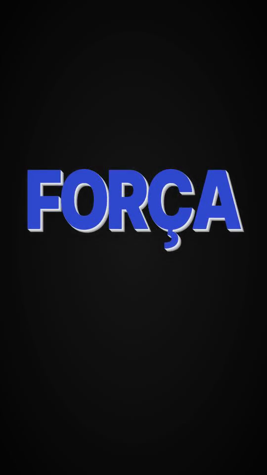
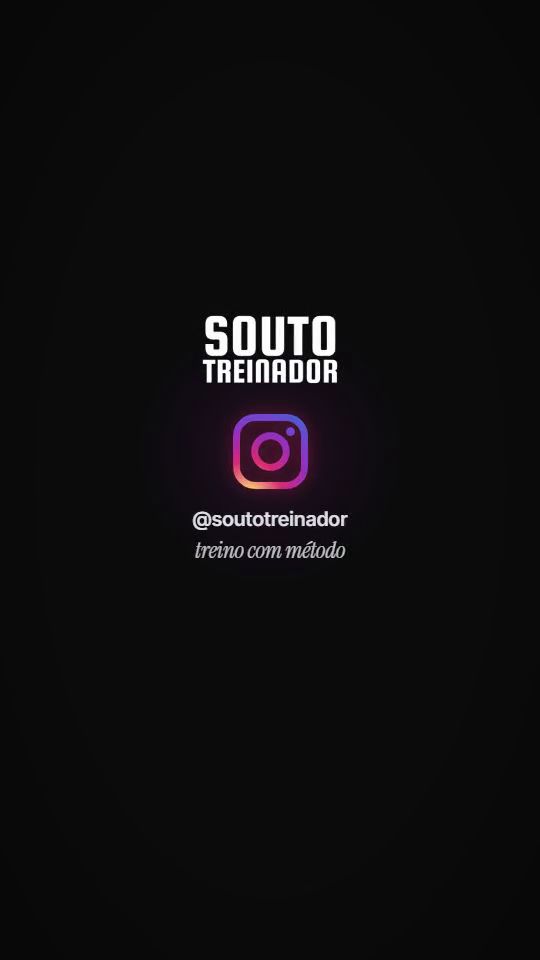

# Guia 04 · Motor de edição de vídeo (SOUTO TREINADOR)

> Para quem é: o Jorge, sem precisar saber programar. Você manda o vídeo bruto (ou um áudio) para o Claude, escolhe o formato e aprova cada etapa; o Claude faz a edição, na identidade azul da marca.
> Tudo o que está em `código` você copia e cola. Os comandos são para o **PowerShell** (menu Iniciar → digite "PowerShell" → abrir).





*Quadros do teste de instalação (vídeo de teste com barras de cor no lugar do rosto): legenda com o destaque azul, palavra de impacto em azul elétrico e card final com a logo e o @.*

---

## Sumário
1. [O que é e como funciona](#1-o-que-é-e-como-funciona)
2. [Os 5 formatos](#2-os-5-formatos)
3. [O que você precisa ter](#3-o-que-você-precisa-ter)
4. [Instalação passo a passo](#4-instalação-passo-a-passo)
5. [Chaves de API grátis (.env)](#5-chaves-de-api-grátis-env)
6. [Antes do primeiro vídeo: @ e CREF](#6-antes-do-primeiro-vídeo--e-cref)
7. [Primeiro uso: o vídeo de teste](#7-primeiro-uso-o-vídeo-de-teste)
8. [Editando um vídeo com /editar (passo a passo)](#8-editando-um-vídeo-com-editar-passo-a-passo)
9. [A ilha de edição (prévia ao vivo)](#9-a-ilha-de-edição-prévia-ao-vivo)
10. [Efeitos sonoros (SFX)](#10-efeitos-sonoros-sfx)
11. [Sua biblioteca de B-roll e músicas](#11-sua-biblioteca-de-b-roll-e-músicas)
12. [Render (gerar o vídeo final)](#12-render-gerar-o-vídeo-final)
13. [Regressão: provar que nada mudou](#13-regressão-provar-que-nada-mudou)
14. [Limites da máquina (memória RAM)](#14-limites-da-máquina-memória-ram)
15. [Licenças (Remotion, sons, fontes, imagens)](#15-licenças-remotion-sons-fontes-imagens)
16. [Problemas comuns (FAQ)](#16-problemas-comuns-faq)
17. [Boas práticas](#17-boas-práticas)
18. [Mapa das pastas](#18-mapa-das-pastas)

---

## 1. O que é e como funciona

O motor é um "editor por código": em vez de arrastar clipes numa linha do tempo, o Claude escreve um arquivo com as decisões de edição (cenas, cortes, textos, efeitos, sons) e um programa chamado **Remotion** transforma isso em vídeo. Isso permite:

- **Formatos fixos e consistentes:** cada formato tem um guia de estilo; todo vídeo sai com o mesmo padrão de qualidade.
- **Tudo na sua identidade:** azul elétrico `#2E49CE`, azul noite `#141A3D`, névoa `#DCE1ED`, papel `#F2F4F8`, preto `#0B0B0E`, logo SOUTO TREINADOR, seu nome e CREF. As cores vêm de um arquivo só (`marca/marca-souto.json`), o mesmo do carrossel e dos documentos.
- **Você aprova por etapas (⏸):** plano → material → prévia → áudio → final. Nada é publicado nem gasto sem o seu ok.
- **Custo zero:** transcrição, edição e render rodam no seu computador. Bancos de imagem gratuitos. Imagens de IA pelo Google Flow (no seu plano Google) só se você quiser.

Onde ficam as coisas:
- **No repositório (GitHub):** só a ferramenta: código, guias de estilo, efeitos sonoros livres, dicionário.
- **No seu computador, fora do repositório:** seus vídeos, brutos, prévias, finais, B-roll, músicas e os modelos de transcrição. Pasta padrão: `C:\Users\<você>\Videos\Souto-Projetos` (variável `SOUTO_VIDEO_PROJETOS`). Isso protege sua privacidade (o repositório é público) e evita encher o OneDrive.

---

## 2. Os 5 formatos

| Formato | Tamanho | Quando usar | Entrada |
|---|---|---|---|
| **INSTAGRAM - TELA DIVIDIDA** | 1080×1920 (9:16), 24 fps | Reels explicativo. B-roll em cima e você embaixo, objetos recortados "voando" na fala, números de estudo em cards de vidro, quebras de padrão a cada 8–20 s. Bom para conteúdo técnico com muita ilustração. | Vídeo seu falando |
| **INSTAGRAM - EDIÇÃO CUT DINÂMICO** | 1080×1920, 24 fps | Reels de ritmo alto: legenda cinética palavra a palavra (destaques em azul), zoom alternando, texto atrás de você, 3D, cards, checklist. O formato "padrão" para dicas rápidas. | Vídeo seu falando |
| **YOUTUBE - MIX EDIT** | 1920×1080 (16:9), 30 fps | Vídeo longo do YouTube: intro cinematográfica com manchetes reais (Text Match Cut), apresentação com nome e CREF, gráficos, capítulos e legenda .srt. | Vídeo horizontal |
| **INSTAGRAM - PAPER VOX ANIMATION** | 1080×1920, 24 fps | Você **não aparece**: só a sua voz narrando. Um mural de papel escuro animado, com palavras-chave nos degradês azuis, fotos e objetos que voam e "boiam". Ótimo para dias sem gravar vídeo. | Só um áudio (pode ser áudio do WhatsApp) |
| **INSTAGRAM - VOX - B-ROLLs** | 1080×1920, 24 fps | Você falando + colagens animadas no estilo "Vox": abertura com texto digitado e cartão azul, colagens que invadem a tela, mural com mergulho, moldura com a cabeça recortada, legenda pequena. O mais elaborado. | Vídeo seu falando |

> O primeiro vídeo de cada formato demora mais: ele vira o seu **piloto** (a referência de qualidade e da regressão). No MIX, PAPER VOX e VOX o Claude escreve um "gerador" do zero no primeiro vídeo; a partir do segundo, ele reaproveita o seu.

Tempo de máquina (medido num notebook de 7,7 GB de RAM, vídeo de ~2 min): CUT/TELA DIVIDIDA ~1 a 1h30 do bruto ao final; PAPER VOX ~3 h (com as suas esperas); VOX ~2–3 h.

---

## 3. O que você precisa ter

| Item | Mínimo | Observação |
|---|---|---|
| Windows | 10 ou 11, 64 bits | Testado no Windows 11 |
| Memória RAM | 8 GB (funciona com 7,7) | Com 8 GB: **um render por vez** (seção 14) |
| Disco livre | 15 GB | ~1 GB de programas e modelos + seus projetos (cada vídeo 0,5–3 GB) |
| Internet | Na instalação e no render | O render baixa as fontes do Google Fonts |
| Conta no Claude | Plano com Claude Code | App do Claude (aba Code) ou Claude Code no terminal |
| Google Chrome + extensão Claude | Opcional | Para gerar imagens no Google Flow e capturar manchetes |
| Placa de vídeo | Não precisa | Se tiver Intel (Quick Sync), o motor usa sozinho; sem ela, usa o processador |

Python **não** é necessário para o vídeo (só para outras frentes).

---

## 4. Instalação passo a passo

### Passo 1 · Abrir o PowerShell
Menu Iniciar → digite `PowerShell` → clique em **Windows PowerShell**. Uma janela azul/preta abre. Cada bloco abaixo: copie, cole (botão direito do mouse cola) e aperte Enter.

### Passo 2 · Baixar o repositório (fora do OneDrive)
O ideal é deixar o repositório **fora** do OneDrive (o motor instala ~500 MB de pacotes que não precisam sincronizar).

1. Instale o Git:
   ```powershell
   winget install --id Git.Git -e --accept-package-agreements --accept-source-agreements
   ```
   Feche e abra o PowerShell de novo. Confira: `git --version` → deve aparecer `git version 2.x`.
2. Clone (troque `<ENDEREÇO DO REPOSITÓRIO>` pelo link do GitHub que está no guia principal):
   ```powershell
   cd $env:USERPROFILE
   git clone <ENDEREÇO DO REPOSITÓRIO> souto-treinador
   cd "$env:USERPROFILE\souto-treinador\04 - EDIÇÃO DE VÍDEO"
   ```

### Passo 3 · Instalador automático (recomendado)
Dentro da pasta `04 - EDIÇÃO DE VÍDEO`, dê **duplo clique em `INSTALAR-VIDEO.bat`** (ou rode `.\INSTALAR-VIDEO.bat` no PowerShell). Ele faz tudo da seção "manual" abaixo, confere cada item e mostra uma tabela OK/FALTA no fim. Pode rodar de novo quantas vezes quiser. Ele abre o Bloco de Notas no `.env`: cole as chaves da seção 5, salve e feche.
- Opções: `.\instalar-video.ps1 -SemWhisperGrande` (pula o modelo grande de 574 MB) e `-SemDeepFilter`.
- Resultado esperado: tudo **OK**; só as chaves aparecem como FALTA se você ainda não criou.

### Passo 3-alternativo · Instalação manual, programa por programa
Use só se o instalador falhar. Depois de cada `winget`, **feche e abra o PowerShell**.

| # | Programa | Para quê | Instalar | Conferir |
|---|---|---|---|---|
| 1 | **Node.js 24 LTS** ([nodejs.org](https://nodejs.org/)) | Roda o motor e os scripts | `winget install --id OpenJS.NodeJS.LTS -e` | `node --version` → `v24.x` (20 ou mais funciona) |
| 2 | **FFmpeg (build full)** ([gyan.dev/ffmpeg](https://www.gyan.dev/ffmpeg/builds/)) | Corta, mede áudio, transcreve (filtro whisper), extrai quadros | `winget install --id Gyan.FFmpeg -e` | `ffmpeg -version` → 8.x ou 9.x; `ffmpeg -hide_banner -filters \| findstr whisper` deve mostrar uma linha |
| 3 | **ffprobe** | Lê duração/tamanho dos vídeos | vem junto com o FFmpeg | `ffprobe -version` |
| 4 | **Git** ([git-scm.com](https://git-scm.com/)) | Baixar e atualizar o repositório | `winget install --id Git.Git -e` | `git --version` |
| 5 | **yt-dlp** ([github.com/yt-dlp/yt-dlp](https://github.com/yt-dlp/yt-dlp)) | Opcional: assistir/analisar vídeos de referência por link (só conteúdo que você tem direito de usar) | `winget install --id yt-dlp.yt-dlp -e` | `yt-dlp --version` |
| 6 | **Pacotes do motor** (Remotion 4.0.532, React, Three.js…) | O editor em si | `cd "...\04 - EDIÇÃO DE VÍDEO\motor"` e depois `npm ci` | `node -e "console.log(require('remotion/package.json').version)"` → `4.0.532` |
| 7 | **Navegador do Remotion** (Chrome Headless Shell) | Desenha cada quadro do vídeo | `npx remotion browser ensure` (dentro de `motor`) | o comando termina sem erro |
| 8 | **Whisper small** ([huggingface.co/ggerganov/whisper.cpp](https://huggingface.co/ggerganov/whisper.cpp)) | Transcrição rápida (`assistir.mjs`) | baixe `ggml-small.bin` (488 MB) para `%USERPROFILE%\Videos\Souto-Projetos\_sistema\modelos\` | sha256 `1be3a9b2…fea987b` (`Get-FileHash`) |
| 9 | **Whisper large-v3-turbo q5** (mesmo link) | Transcrição de alta qualidade (PAPER VOX, VOX, decupagem) | `ggml-large-v3-turbo-q5_0.bin` (574 MB), mesma pasta | sha256 `39422170…a7e2` |
| 10 | **DeepFilterNet 0.5.6** ([github.com/Rikorose/DeepFilterNet/releases](https://github.com/Rikorose/DeepFilterNet/releases/tag/v0.5.6)) | Opcional: redução de ruído no "estúdio de áudio" | baixe `deep-filter-0.5.6-x86_64-pc-windows-msvc.exe`, renomeie para `deep-filter.exe` em `...\Souto-Projetos\_sistema\ferramentas\deepfilternet\` | `& "...\deep-filter.exe" --version` → `0.5.6` |
| 11 | **SFX das peças** | Sons livres com os nomes que as peças pedem | dentro de `motor`: `node scripts/sfx/sfx-substitutos.mjs` | "77 criados" |
| 12 | **Recorte de pessoa** (HyperFrames, modelo u2net, 168 MB) | Texto atrás de você (CUT, MIX, VOX) | nada: baixa sozinho no 1º uso via `npx hyperframes` (pede internet uma vez) | o 1º recorte funciona |
| 13 | **Google Chrome ou Edge** | Opcional: capturar manchetes reais (`capturar-manchete.mjs`) e operar o Google Flow pela extensão do Claude | `winget install --id Google.Chrome -e` (o Edge já vem no Windows) | abre normalmente |

> Os sha256 completos estão no `instalar-video.ps1`. Se o hash não bater, apague o arquivo e baixe de novo.

### Passo 4 · Configurar o Claude Code (uma vez)
Peça ao Claude: *"Configure a ilha de edição e o hook do validador de vídeo no `.claude` da raiz, conforme o guia 04-video"*. Ele vai acrescentar:

`.claude/launch.json` (ilha de edição):
```json
{
  "version": "0.0.1",
  "configurations": [
    {"name": "ilha", "runtimeExecutable": "node", "runtimeArgs": ["04 - EDIÇÃO DE VÍDEO/motor/scripts/ilha.mjs"], "port": 3123, "url": "http://127.0.0.1:3123"}
  ]
}
```
`.claude/settings.json` (validador automático a cada mudança do `edicao.json`):
```json
{
  "hooks": {
    "PostToolUse": [
      {"matcher": "Write|Edit", "hooks": [{"type": "command", "command": "node \"$CLAUDE_PROJECT_DIR/04 - EDIÇÃO DE VÍDEO/motor/scripts/validar-edicao.mjs\" --hook", "timeout": 120}]}
    ]
  }
}
```
(Se o arquivo já existir, as linhas são **acrescentadas**, sem apagar as outras.)

---

## 5. Chaves de API grátis (.env)

O arquivo `.env` fica na **raiz do repositório** (`souto-treinador\.env`), é criado a partir do `.env.example` e **nunca vai para o GitHub**. Abra com o Bloco de Notas:
```powershell
notepad "$env:USERPROFILE\souto-treinador\.env"
```

| Variável | Obrigatória? | Para quê |
|---|---|---|
| `SOUTO_VIDEO_PROJETOS` | Não (vazio = `%USERPROFILE%\Videos\Souto-Projetos`) | Pasta dos seus projetos, biblioteca e modelos. Deixe no disco C:, fora do OneDrive |
| `PEXELS_API_KEY` | Recomendada | Vídeos e fotos grátis do Pexels |
| `PIXABAY_API_KEY` | Recomendada | Vídeos, fotos e ilustrações grátis do Pixabay |
| `GEMINI_API_KEY` | Não (e não recomendado: pode gerar custo) | Só para `gen.mjs`, gerador de emergência por API |
| `GEMINI_BUDGET_USD` | Não | Teto de gasto do `gen.mjs` |
| `SOUTO_VOZ_REFERENCIA` | Não | Uma gravação sua aprovada, usada como alvo pelo estúdio de áudio |

O Openverse (imagens de domínio público e Creative Commons) **não precisa de chave**.

### Pexels (grátis)
1. Crie a conta em [pexels.com/join](https://www.pexels.com/join/) (e-mail e senha seus).
2. Entre em [pexels.com/api](https://www.pexels.com/api/) e clique em **Get Started** / **Your API Key**.
3. Preencha o formulário curto (descrição: "edição dos meus vídeos de treino", uso pessoal) e aceite os termos.
4. A chave (uma sequência longa de letras e números) aparece na tela. Copie.
5. No `.env`: `PEXELS_API_KEY=cole_aqui` (sem espaços, sem aspas). Salve.

### Pixabay (grátis)
1. Crie a conta em [pixabay.com/accounts/register](https://pixabay.com/accounts/register/) e confirme o e-mail.
2. Logado, abra [pixabay.com/api/docs](https://pixabay.com/api/docs/).
3. Na seção **Parameters**, linha `key`, aparece a **sua chave** destacada. Copie.
4. No `.env`: `PIXABAY_API_KEY=cole_aqui`. Salve.

### Conferir
Dentro de `motor`, com um projeto criado (seção 7):
```powershell
node scripts/stock.mjs "<pasta do projeto>" teste "athlete gym training" --image --n 2
```
Deve listar 2 arquivos baixados. "indisponível: 401" = chave errada.

> Nunca mande a chave por chat, e-mail ou print. Se vazar, gere outra no site e troque no `.env`.

---

## 6. Antes do primeiro vídeo: @ e CREF

Abra `04 - EDIÇÃO DE VÍDEO\marca-video.json` no Bloco de Notas e troque os campos da lista `TROCAR`:
```json
"arroba": "@soutotreinador",
"registro": "CREF 000000-G/UF",
```
Coloque o seu @ real e o seu CREF completo (ex.: `CREF 123456-G/SP`). Os mesmos dados aparecem no card de apresentação (MIX), no card final (CUT e TELA DIVIDIDA) e no card da marca (PAPER VOX). Cores e logo vêm de `marca\marca-souto.json` e `marca\logo\` (não precisa mexer aqui).

---

## 7. Primeiro uso: o vídeo de teste

Prova de que tudo está instalado, sem usar vídeo seu (gera barras de cor com um bipe):
```powershell
cd "$env:USERPROFILE\souto-treinador\04 - EDIÇÃO DE VÍDEO\motor"
ffmpeg -y -f lavfi -i "smptehdbars=s=1080x1920:r=24:d=6" -f lavfi -i "sine=frequency=440:duration=6" -c:v libx264 -pix_fmt yuv420p -c:a aac -shortest "$env:TEMP\barras.mp4"
node scripts/novo-projeto.mjs "teste azul" "$env:TEMP\barras.mp4"
```
O último comando mostra a pasta criada. Depois peça ao Claude: *"No projeto teste azul, monte um edicao.json de CUT DINÂMICO de 6 s com a palavra FORÇA e o card final, valide e renderize a prévia."* Em ~1 minuto sai `06_previas\previa_..._cut.mp4` com os quadros parecidos com os do topo deste guia. Apague a pasta de teste depois.

---

## 8. Editando um vídeo com /editar (passo a passo)

Abra o Claude Code na pasta `souto-treinador` e digite `/editar` seguido do caminho do bruto (ou arraste o arquivo para o chat):
```
/editar "C:\Users\<você>\Downloads\video-agachamento.mp4" agachamento profundo
```

**Etapa 0 · perguntas iniciais (sempre):**
1. **Plataforma:** Instagram (vertical) ou YouTube (horizontal).
2. **Formato** (só Instagram): TELA DIVIDIDA, CUT DINÂMICO, PAPER VOX ou VOX - B-ROLLs.
3. **O que fazer no bruto** (marque só o que precisa): *Decupar* (tirar silêncios, erros e repetições), *Corrigir cor* (só para vídeo de câmera em perfil log), *Ajustar o áudio*, ou *Nenhum: já vem tratado*.
   - Mandou só um áudio? Vai para o PAPER VOX e a pergunta é só "Ajustar o áudio?".

**Depois, o Claude segue sozinho e para nos ⏸:**

| # | Etapa | O que acontece | Você faz |
|---|---|---|---|
| 1 | Projeto | Cria `Souto-Projetos\AAAA-MM-DD_nome\` e copia o bruto | nada |
| 2 | Assistir | Transcreve palavra a palavra (local, nada sai do PC) e tira folhas de quadros | nada |
| 2b | Decupagem (se marcou) | Marca o que sai e por quê | revisa se ele pedir |
| 3 | **Plano ⏸** | Tabela cena a cena: fala, layout, B-roll, transições, destaques, créditos do Flow | aprova ou pede ajuste |
| 4 | **Material ⏸** | Busca primeiro na sua biblioteca, depois Pexels/Pixabay/Openverse, depois imagens do Flow; lista de prompts e créditos para aprovar; 2–3 músicas com link | aprova prompts, créditos, downloads e música |
| 5 | Montagem | O agente `montador` escreve o `edicao.json` e o validador confere as regras do formato até 0 ERRO | nada |
| 6 | **Ilha ⏸** | Abre a prévia ao vivo (seção 9) | assiste e pede ajustes com o tempo ("0:12 troca a imagem") |
| 7 | Ajustes | Edita, a ilha atualiza em segundos | aprova ("aprovado") |
| 7b | **Voz ⏸** | Pergunta se quer tratar o áudio; se sim, gera 2–3 versões e um comparativo | escolhe ouvindo |
| 7c | Render final | Gera o mp4 final (avisa o tempo antes) | espera; não feche o app |
| 8 | Biblioteca | Guarda o material bom para os próximos vídeos | nada |

**PAPER VOX (só áudio)** e **VOX - B-ROLLs** têm fluxo próprio com mais paradas: dúvidas da transcrição ⏸ → cenas/plano ⏸ → prompts do Flow ⏸ → imagens ⏸ → prévia renderizada com 2 trilhas ⏸ → **refino dos SFX** (um "carretel" com cada efeito; você pede por número: "o 7 entra 2 quadros antes") ⏸ → final ⏸. Não há ilha nesses dois.

**Google Flow (imagens e vídeos de IA):** o Claude opera o site [labs.google/fx/tools/flow](https://labs.google/fx/tools/flow) pelo **seu** Chrome (extensão Claude ativa e você logado). Imagens (Nano Banana) costumam custar 0 crédito no plano; vídeos custam créditos do seu plano Google AI: ele sempre mostra a estimativa e espera o seu ok. Ele nunca compra créditos nem aceita termos por você.

---

## 9. A ilha de edição (prévia ao vivo)

A "ilha" é o Remotion Studio aberto com o seu projeto: você assiste a edição no painel do navegador do app, sem esperar render.
- O Claude abre com `preview_start ilha` (configurado no passo 4) ou, sem a configuração, com:
  ```powershell
  cd "$env:USERPROFILE\souto-treinador\04 - EDIÇÃO DE VÍDEO\motor"
  node scripts/ilha.mjs "<pasta do projeto>"
  ```
- Endereço: `http://127.0.0.1:3123/<composição>` (`CutDinamico`, `TelaDividida2`, `MixEdit`).
- Como pedir ajuste: sempre com o tempo. "1:23 tira o zoom", "0:45 troca o B-roll por algo de academia", "0:08 a palavra ficou em cima do rosto".
- A cada mudança no `edicao.json` a prévia se atualiza em segundos. Trechos pesados (3D, recortes) podem engasgar ao tocar: o render final é fiel.
- Depois do "aprovado", a ilha é fechada para liberar memória antes do render.
- Não existe ilha no PAPER VOX e no VOX (a prévia é renderizada em meia resolução).

---

## 10. Efeitos sonoros (SFX)

### O que já vem pronto
- **133 sons Glitch Noises** (Vladislav Zharkov, licença **CC0**, domínio público; prova em `sfx\lab\licencas\`): cliques, notificações, sons futuristas, glitches, whooshes e impactos, em `sfx\lab\<categoria>\`.
- **6 sons de papel** e **11 sons sintetizados** pelo próprio motor (`synth-sfx.mjs`): licença própria, sem Content ID.
- **Pasta de compatibilidade `sfx\biblioteca\motionix\`**: o motor foi calibrado com um pacote chamado Motionix (77 efeitos), que **não pode ser redistribuído** (não tem licença de redistribuição). O instalador cria essa pasta com os sons livres mais parecidos, com os mesmos nomes, para todas as peças terem som. Se um dia você comprar/obtiver legalmente um pacote equivalente, pode colocar os arquivos nessa pasta com os mesmos nomes (lista em `sfx\biblioteca\motionix-nomes.tsv`).

### Melhorar os sons: Mixkit (grátis, você baixa à mão)
A licença do Mixkit permite usar em vídeos comerciais, YouTube, redes e anúncios sem crédito, mas **proíbe redistribuir os sons** (por isso não estão no repositório), registrar no Content ID e **baixar em massa por robô**: quem clica é você.
1. Abra a lista pronta no Chrome: `04 - EDIÇÃO DE VÍDEO\sfx\lab\lista-mixkit.html` (duplo clique). São 184 sons escolhidos para os formatos; os 83 com ★ são os essenciais. Cada um tem ▶ para ouvir e o link da página.
2. Para cada som: abra o link → botão **Download** (formato WAV). Os arquivos chegam em `Downloads` como `mixkit-<nome>-<número>.wav`. A lista marca o que você já baixou.
3. Importe tudo de uma vez:
   ```powershell
   cd "$env:USERPROFILE\souto-treinador\04 - EDIÇÃO DE VÍDEO\motor"
   node scripts/sfx/sfx-importar-mixkit.mjs
   ```
   Ele converte para 48 kHz, mede o volume de cada um, cataloga em `sfx\lab\catalogo.tsv` e manda os originais da pasta Downloads para a Lixeira (use `--manter` para não mexer em Downloads; `--pasta <outra pasta>` se baixou em outro lugar). No fim mostra quantos ★ faltam.
4. Pronto: o `sfx-variado.mjs`, o gerador do PAPER VOX e o do VOX passam a sortear também esses sons.
   - Licença conferida em out/2026; confira a versão atual em [mixkit.co/license](https://mixkit.co/license/) (seção Sound Effects).

### 99Sounds Sci-Fi Sound Effects (grátis, você baixa)
Royalty-free, uso pessoal e comercial, crédito opcional, **proíbe redistribuir**.
1. Baixe em [99sounds.org](https://99sounds.org/) (procure "Sci-Fi Sound Effects"; pode pedir e-mail pelo Gumroad). É um zip de ~414 MB.
2. Descompacte numa pasta, por exemplo `Downloads\99sounds`.
3. Escolha os sons (o Claude pode ajudar: *"escolha 30 sons do 99Sounds para glitch, futurista e impacto e monte o lote"*) e crie um arquivo `lote-99.json`:
   ```json
   {"origem": "99Sounds Sci-Fi Sound Effects", "licenca": "99Sounds (royalty-free, uso comercial, sem redistribuir)", "url": "https://99sounds.org/",
    "itens": [{"arquivo": "C:\\Users\\<você>\\Downloads\\99sounds\\<pasta>\\<som>.wav", "categoria": "futurista", "nome": "99-beep-01", "descricao": "bip curto"}]}
   ```
   Categorias: `clique`, `ding`, `futurista`, `glitch`, `impacto`, `scroll-ui`, `whoosh`, `papel`.
4. Importe: `node scripts/sfx/sfx-catalogar.mjs "C:\caminho\lote-99.json"` (pode rodar de novo: o que já está no catálogo é pulado).

### Outras ferramentas de som
- `node scripts/synth-sfx.mjs <pasta>`: gera de novo os sons sintetizados.
- `node scripts/sfx/sfx-variado.mjs <proj>`: troca os sons automáticos repetitivos por sons variados, com volume medido (formato Tela Dividida clássico).
- `node scripts/refinar-sfx.mjs <proj>`: refino milimétrico (PAPER VOX e VOX).
- `node scripts/sfx/sfx-substitutos.mjs --forcar`: refaz a pasta de compatibilidade (útil depois de importar o Mixkit).

> Os sons do Mixkit/99Sounds ficam só no seu PC: o `.gitignore` impede que subam para o GitHub (só sobem os `*_gn-*` e os de papel). Não mude isso.

---

## 11. Sua biblioteca de B-roll e músicas

Fica em `Souto-Projetos\_biblioteca\` (fora do repositório; nada é distribuído):
```
_biblioteca\
  broll-reutilizavel\<tema>\...   imagens e vídeos aprovados
  catalogo.json                   tema, tags, descrição, origem, licença, crédito
  musicas\                        trilhas aprovadas + catalogo.md
```
- **Buscar no banco grátis** (dentro de `motor`):
  ```powershell
  node scripts/stock.mjs "<pasta do projeto>" c01 "woman squat gym" --n 3            # vídeos verticais (Pixabay → Pexels)
  node scripts/stock.mjs "<pasta do projeto>" c02 "dumbbell" --image --n 3           # fotos (Pixabay → Openverse → Pexels)
  node scripts/stock.mjs "<pasta do projeto>" c03 "muscle anatomy" --ilustracao       # ilustrações do Pixabay
  node scripts/stock.mjs "<pasta do projeto>" c04 "barbell" --horizontal              # 16:9 para o YouTube
  node scripts/stock.mjs "<pasta do projeto>" c05 "olympic lifting" --fonte openverse # só domínio público/CC
  ```
  A busca é em **inglês**. Os arquivos vão para `04_broll\banco` (vídeo) ou `04_broll\fotos` (imagem), e os créditos/licenças para `04_broll\creditos.json`.
- **Reaproveitar:** `node scripts/biblioteca.mjs buscar agachamento joelho` (busca em português nas tags) e `node scripts/biblioteca.mjs listar`.
- **Guardar no fim de cada vídeo:** o Claude monta um `03_roteiro/lote_biblioteca.json` com o material bom e roda `node scripts/biblioteca.mjs importar <lote>`. Você não precisa fazer nada.
- **Músicas:** o Claude busca no [Pixabay Music](https://pixabay.com/music/) conforme o clima do vídeo, mostra 2–3 opções com link e duração, e baixa só a que você aprovar. Trilhas aprovadas vão para `_biblioteca\musicas\` com uma linha no `catalogo.md` (mood, duração, licença, onde foi usada). O volume é sempre medido: no máximo 1/4 da voz.
- **Cuidados de licença:** Pexels/Pixabay permitem uso comercial sem crédito (não revenda o arquivo avulso, não use pessoas/marcas em contexto ofensivo); Openverse: respeite a licença de cada imagem (o crédito fica no `creditos.json`). Nada de foto do Google Imagens (tem dono). Antes de publicar no YouTube com música do Pixabay, confira se há aviso de Content ID na página da trilha.

---

## 12. Render (gerar o vídeo final)

O Claude cuida disso, mas é bom saber:
```powershell
cd "$env:USERPROFILE\souto-treinador\04 - EDIÇÃO DE VÍDEO\motor"
node scripts/vez.mjs node scripts/render.mjs "<pasta do projeto>" --previa              # meia resolução → 06_previas
node scripts/vez.mjs node scripts/render.mjs "<pasta do projeto>" --previa --trecho 0 15 # só um trecho
node scripts/vez.mjs node scripts/render.mjs "<pasta do projeto>"                        # final → 07_final\<nome>_final.mp4
node scripts/vez.mjs node scripts/render.mjs "<pasta do projeto>" --partes auto --manter-partes --concurrency 3   # MIX longo, retomável
node scripts/vez.mjs node scripts/render-paper-vox.mjs "<pasta>" --previa               # PAPER VOX
node scripts/vez.mjs node scripts/render-vox.mjs "<pasta>" --previa                     # VOX - B-ROLLs
```
- `vez.mjs` é a **fila**: garante um render por vez (essencial com 8 GB de RAM).
- O áudio final sai em −14 LUFS (padrão das redes). Instagram: 1080×1920 a 24 fps.
- Tempos de referência: prévia ≈ 3 s de máquina por segundo de vídeo; final 9:16 ≈ 6–10 s por segundo (vídeo de 1 min ≈ 6–10 min); PAPER VOX final ≈ 12 s por segundo.
- Durante render longo: não feche o app do Claude, não deixe o PC suspender (peça "mantenha o computador acordado"), evite abrir o Chrome com muitas abas.

---

## 13. Regressão: provar que nada mudou

Os formatos são fixos. Se alguém mudar o código do motor (atualização, peça nova, ajuste), a regressão renderiza trechos de um vídeo seu já aprovado e compara **quadro a quadro** com a referência gravada. Resultado: **IDÊNTICO**, **EQUIVALENTE** (só ruído de decodificação, medido em PSNR) ou **ATENÇÃO** (algo mudou de verdade).

Configurar (uma vez por formato, depois do 1º vídeo aprovado nele):
1. Copie `Souto-Projetos\_sistema\regressao\pilotos.exemplo.json` para `pilotos.json` na mesma pasta.
2. Em cada formato, troque `proj` pelo nome da pasta do vídeo aprovado (ex.: `2026-12-02_agachamento-profundo`) e escolha 1–3 `trechos` curtos (em segundos) que mostrem o formato. Apague as chaves dos formatos que você ainda não usou.
3. Grave a referência uma vez (pela fila):
   ```powershell
   node scripts/vez.mjs node scripts/regressao.mjs --cut --gravar
   ```
   (`--td2` Tela Dividida, `--cut` CUT, `--mix` MIX; PAPER VOX: `regressao-paper-vox.mjs --gravar`; VOX: `regressao-vox.mjs --gravar` usa trechos do seu final aprovado.)
4. Depois de qualquer mudança no motor, rode sem `--gravar`, um por vez:
   ```powershell
   node scripts/vez.mjs node scripts/regressao.mjs --td2
   node scripts/vez.mjs node scripts/regressao.mjs --cut
   node scripts/vez.mjs node scripts/regressao.mjs --mix
   node scripts/vez.mjs node scripts/regressao-paper-vox.mjs
   node scripts/vez.mjs node scripts/regressao-vox.mjs
   ```
   Formato sem piloto → mensagem "piloto não configurado" (normal).
- **ATENÇÃO** = não aceite referência nova sem entender o motivo (outra versão do FFmpeg, outra placa de vídeo, mudança de código). Só regrave (`--gravar`) quando você aprovar a mudança visual.
- As referências ficam em `Souto-Projetos\_sistema\regressao\` (têm o seu rosto: nunca vão para o GitHub).

---

## 14. Limites da máquina (memória RAM)

Com ~8 GB de RAM:
- **Um render, recorte ou conversão pesada por vez** (o `vez.mjs` organiza a fila). Dois renders juntos travam o PC.
- No máximo 2–3 agentes do Claude em paralelo.
- Prévias em meia resolução; render com `--concurrency=2` (VOX usa 1).
- Antes de gerar no Flow, recortar ou renderizar: tenha ≥ 2 GB livres (Gerenciador de Tarefas → Desempenho → Memória). Feche o Chrome com muitas abas, jogos e editores.
- Recorte de pessoa (texto atrás de você) é a etapa mais cara: ~1,3 s por quadro; use só nos momentos-chave.
- Vídeos de câmera 4K/10 bits pesam muito: se puder, exporte do celular/câmera em **1080×1920, 24 fps, H.264** (Instagram) ou 1080p até 60 fps (YouTube).

---

## 15. Licenças (Remotion, sons, fontes, imagens)

| Item | Licença | O que significa para você |
|---|---|---|
| **Remotion** (o editor) | Remotion License (conferida em [remotion.dev/docs/license](https://www.remotion.dev/docs/license) em nov/2026) | **Grátis para pessoas físicas e empresas de até 3 pessoas.** Empresa maior precisa de licença paga (planos "Remotion for Creators", US$ 25/mês por pessoa, ou "for Automators"). Se a sua empresa crescer além de 3 pessoas, confira a página e contrate. |
| Glitch Noises (133 SFX) | CC0 1.0 | Livre, sem crédito |
| SFX sintetizados e de papel | Próprios (feitos por código) | Livres |
| Mixkit / 99Sounds | Licenças próprias, grátis para uso comercial, **sem redistribuir** | Você baixa; ficam só no seu PC |
| Fontes (Instrument Serif, Inter Tight, Inter, Anton e outras do Google Fonts) | SIL Open Font License | Livres para vídeo comercial; baixadas no render, não vêm no repositório |
| Dicionário pt-BR (LibreOffice, `ferramentas\dicionario-ptbr`) | LGPLv3 / MPL | Pode redistribuir com o aviso (incluído) |
| Whisper (modelos ggml) | MIT | Livre |
| FFmpeg | GPL (build do gyan.dev) | Usado como programa, não redistribuído |
| three.js, React, lottie-web | MIT · lucide-react ISC · simple-icons CC0 | Livres; logos das redes continuam marcas de cada rede (só no card final, sem alterar) |
| HyperFrames (recorte) / u2net | Apache-2.0 | Livre |
| Pexels / Pixabay | Licenças próprias, uso comercial sem crédito | Não revender o arquivo avulso |
| Openverse | Varia por imagem (CC0, CC BY…) | Crédito guardado em `creditos.json`; coloque na legenda quando a licença pedir |

---

## 16. Problemas comuns (FAQ)

1. **"winget não é reconhecido"** → Atualize o "Instalador de Aplicativo" pela Microsoft Store e abra o PowerShell de novo. Alternativa: baixe cada programa pelo site (links da tabela do passo 3).
2. **"node/ffmpeg não é reconhecido" logo depois de instalar** → Feche e abra o PowerShell (ou reinicie o PC). O PATH só atualiza em janela nova.
3. **`npm ci` falha com erro de rede ou "EPERM"** → Confira a internet, feche o VS Code/Explorer que esteja aberto na pasta `motor` e rode de novo. Repositório dentro do OneDrive: pause a sincronização durante a instalação ou mova o repositório para fora (passo 2).
4. **Aviso "allow-scripts … esbuild" no `npm ci`** → É só aviso do npm 11; o motor funciona (testado). Se o render reclamar do esbuild: `npm approve-scripts esbuild` e `npm ci` de novo.
5. **"Timeout while extracting frame" no render** → B-roll de banco com poucos quadros-chave. Rode `node scripts/normalizar-broll.mjs <proj>` e renderize de novo (o Claude já faz antes do render).
6. **"No frame found at position…"** → Falha passageira do compositor no Windows; o `render.mjs` tenta de novo sozinho. Se repetir, rode o mesmo comando.
7. **O Windows bloqueou um .exe/.dll do Remotion ("Controle Inteligente de Aplicativos", código 0xC0E90002)** → Não desligue a segurança. O motor detecta e passa a usar o FFmpeg do sistema (`scripts/lib/binarios.mjs`). Confira se o FFmpeg está instalado (passo 3).
8. **"Não achei o edicao.json" / a ilha não abre** → Passe a pasta do projeto: `node scripts/ilha.mjs "<pasta>"`, ou grave o nome da pasta em `Souto-Projetos\.projeto-ativo`. PAPER VOX e VOX não têm ilha.
9. **Porta 3123 ocupada** → Já há uma ilha aberta. Feche a outra (ou o processo `node` no Gerenciador de Tarefas) e abra de novo.
10. **O PC travou / Chrome congelou durante o render** → Memória cheia. Feche programas, espere o render (ou cancele) e rode um por vez pela fila (`vez.mjs`). Se uma trava ficou presa, apague a pasta `Souto-Projetos\_sistema\.fila-render`.
11. **Transcrição veio vazia ou com palavras erradas** → Confira se o filtro whisper existe (`ffmpeg -hide_banner -filters | findstr whisper`) e se os modelos estão em `_sistema\modelos`. Termos técnicos errados: o Claude corrige com `corrigir-palavras.mjs`; acrescente termos seus em `04 - EDIÇÃO DE VÍDEO\ferramentas\glossario.txt` (um por linha).
12. **"Nenhum resultado" ou "401" no `stock.mjs`** → Busca em português (use inglês) ou chave errada/vazia no `.env` (seção 5). Sem chaves, só o Openverse funciona (e só imagens).
13. **Peça sem som / validador acusa "som … não existe"** → Rode `node scripts/sfx/sfx-substitutos.mjs` (cria a pasta `motionix`). Depois de importar o Mixkit, `--forcar` não é necessário (os nomes são outros).
14. **As fontes saíram diferentes / erro ao carregar fonte** → O render baixa as fontes do Google Fonts: precisa de internet. Rode de novo com a conexão ok.
15. **O vídeo ficou com a cor estranha** → O motor não mexe na cor por padrão. Se você marcou "Corrigir cor", escolha "nenhuma" no comparativo. Bruto de celular normal não precisa.
16. **Música alta demais** → Peça "música mais baixa": o volume é recalculado sobre a sua voz (regra: no máximo 1/4 da voz). Só o áudio é refeito.
17. **A legenda ficou em cima do rosto / texto cortado** → Peça na ilha com o tempo ("0:14 sobe a legenda"). O validador já barra texto saindo da tela no CUT.
18. **Regressão diz "piloto não configurado"** → Normal até você aprovar o 1º vídeo no formato e configurar o `pilotos.json` (seção 13).
19. **Regressão deu ATENÇÃO** → Algo mudou no visual. Veja o que mudou (atualização? outra máquina?) antes de regravar. Só regrave com `--gravar` se você aprovar o novo visual.
20. **Quero mudar a cor da marca** → Edite `marca\marca-souto.json` (vale para todas as frentes). No próximo render o vídeo acompanha.
21. **Quero trocar @ ou CREF** → `04 - EDIÇÃO DE VÍDEO\marca-video.json` (seção 6).
22. **O PC suspendeu no meio do trabalho** → Peça ao app "mantenha o computador acordado" em trabalho longo, ou ajuste a energia do Windows para não suspender na tomada.
23. **Erro "caminho muito longo"** → Deixe `SOUTO_VIDEO_PROJETOS` curto (ex.: `C:\Souto-Projetos`) e nomes de projeto curtos.
24. **Atualizar o motor (versão nova do repositório)** → `cd "$env:USERPROFILE\souto-treinador"; git pull`, depois rode `INSTALAR-VIDEO.bat` de novo e as regressões (seção 13).

---

## 17. Boas práticas

- **Grave pensando na edição:** 1080×1920 a 24 fps para o Instagram, boa luz no rosto, microfone de lapela com ganho baixo, sem "aprimorar voz"/redução de ruído do celular. Deixe 1 s de silêncio no começo e no fim.
- **Mande bruto já decupado quando puder:** economiza 20–60 min de máquina. Se não, marque "Decupar".
- **Aprove o plano com calma:** é a etapa mais barata para mudar ideia. Depois do render, mudar custa tempo.
- **Ajuste na ilha, não em renders:** peça todas as mudanças na ilha e só depois aprove o final.
- **Sem repetição visual:** o mesmo B-roll nunca duas vezes no vídeo; termos repetidos ganham imagens diferentes.
- **Afirmações técnicas na tela com fonte:** números e estudos vêm do roteiro (seção Fontes); o Claude não inventa dado.
- **Pessoas reais:** nunca gere por IA a imagem de alguém real; manchetes reais só capturadas (`capturar-manchete.mjs`), sem "melhorar" por IA.
- **Vídeo aprovado é intocável:** ajuste pedido depois muda só aquilo.
- **Um render por vez**, e nada pesado aberto enquanto renderiza.
- **Backup:** a pasta `Souto-Projetos` não está no GitHub. Copie os finais e a pasta `_biblioteca` para um HD externo ou Google Drive de vez em quando. Os pilotos da regressão (pasta do projeto + `_sistema\regressao`) também.
- **Privacidade:** nunca coloque vídeos, fotos de alunos ou chaves dentro da pasta do repositório. O repositório é público.
- **Formatos fixos:** quer um estilo novo? Use `/novo-modelo` com vídeos de referência; os 5 formatos não mudam sem você pedir.

---

## 18. Mapa das pastas

```
souto-treinador\                         (repositório, GitHub)
  .env                                   suas chaves (não sobe)
  marca\marca-souto.json, logo\          cores e logo (todas as frentes)
  .claude\skills\editar, novo-modelo     comandos /editar e /novo-modelo
  .claude\agents\04-video\               montador, decupador, revisor-de-video, diretores…
  04 - EDIÇÃO DE VÍDEO\
    CLAUDE.md                            manual do motor para o Claude
    INSTALAR-VIDEO.bat / instalar-video.ps1
    marca-video.json                     nome, cargo, @, CREF (TROCAR)
    Decisões de edição.md                padrões de estilo (você pode mudar)
    motor\                               Remotion + scripts (node_modules não sobe)
      scripts\stock.mjs                  banco de imagens (usado também pelo carrossel)
      scripts\lib\caminhos.mjs           mapa de pastas
    referencias\modelos\<formato>\guia-de-estilo.md
    referencias\MANUAL-COMPLETO-DO-MOTOR.md
    kit\KIT.md                           catálogo das peças de motion
    sfx\lab\                             Glitch Noises CC0 + Mixkit/99Sounds que você importar
    sfx\biblioteca\                      sintetizados + motionix\ (gerada)
    ferramentas\                         dicionário pt-BR + glossario.txt
C:\Users\<você>\Videos\Souto-Projetos\   (SOUTO_VIDEO_PROJETOS, fora do GitHub e do OneDrive)
  AAAA-MM-DD_nome\01_bruto 02_analise 03_roteiro 04_broll 05_audio 06_previas 07_final
  _biblioteca\broll-reutilizavel, musicas, catalogo.json
  _sistema\modelos (Whisper), ferramentas (DeepFilterNet), regressao, render-partes, .fila-render
```
