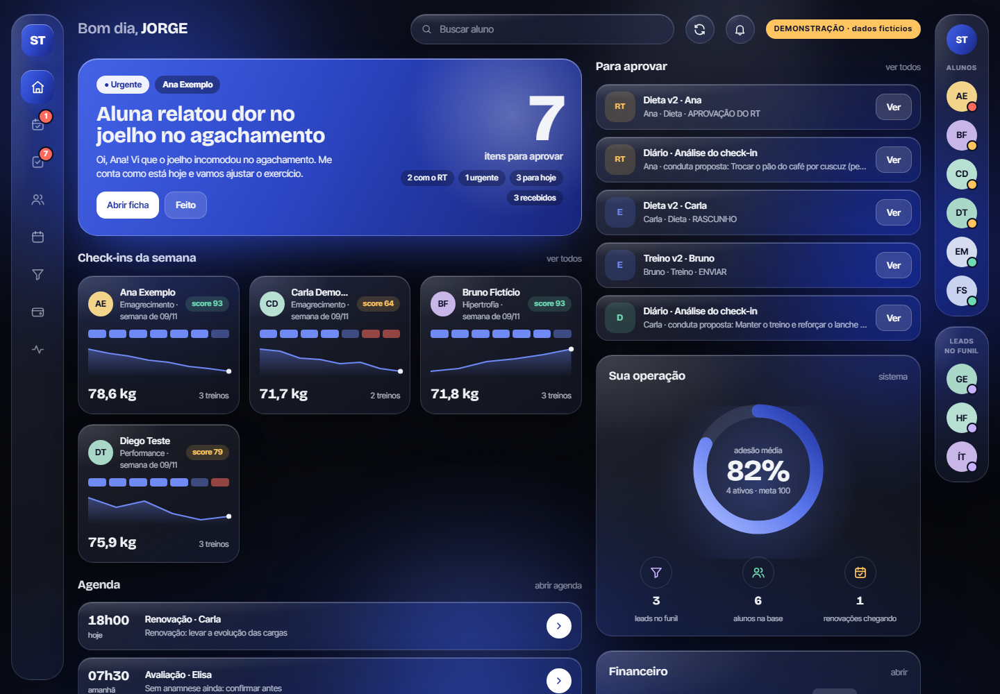
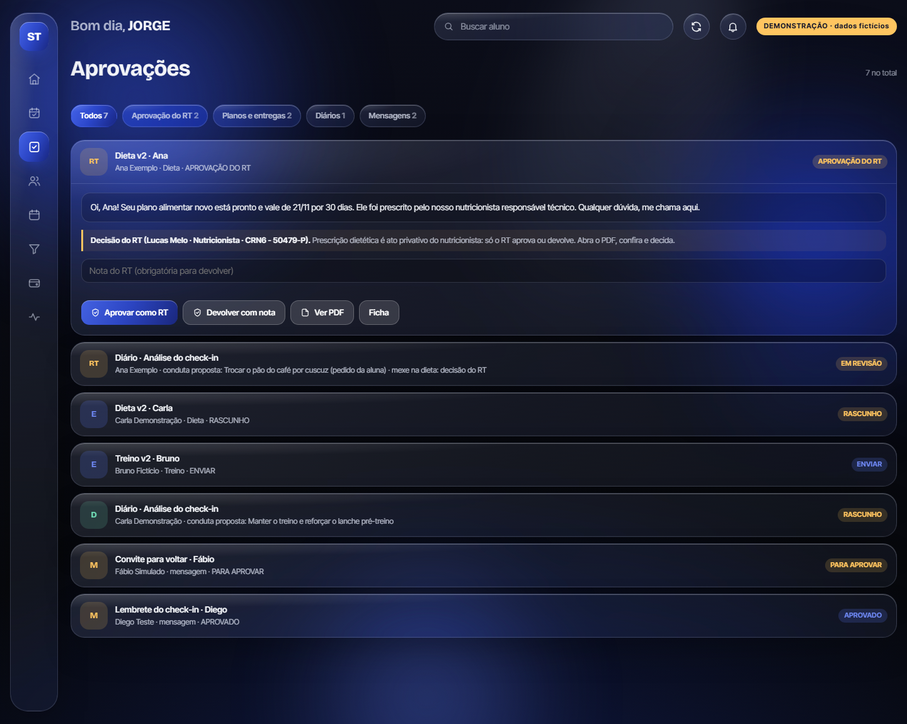
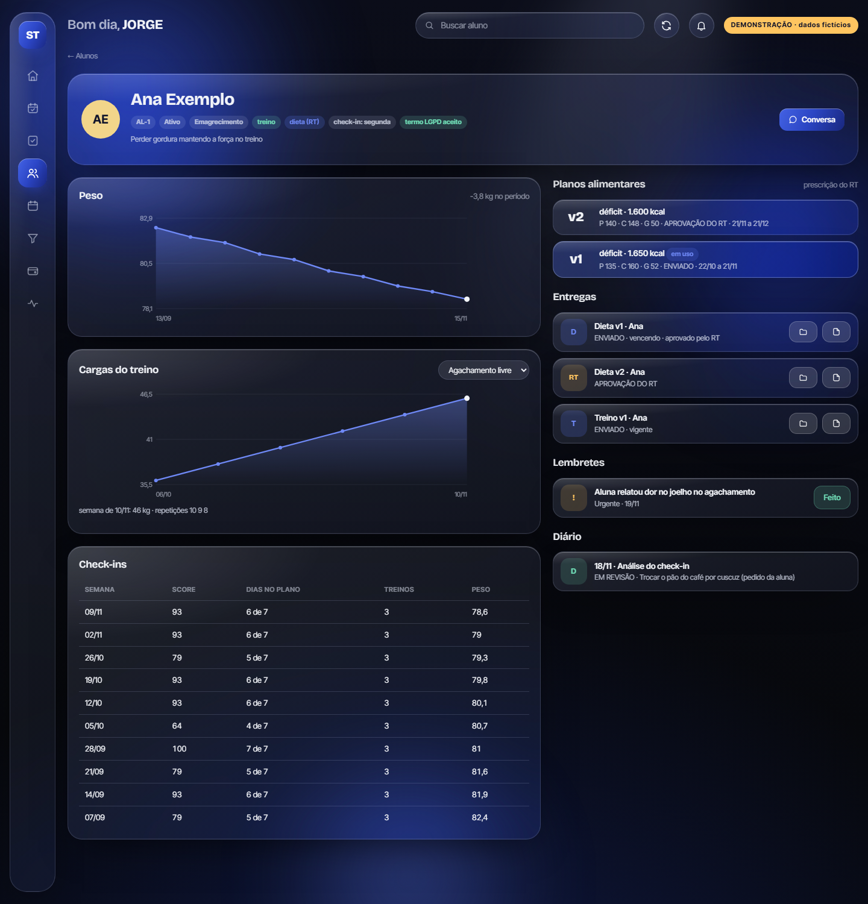
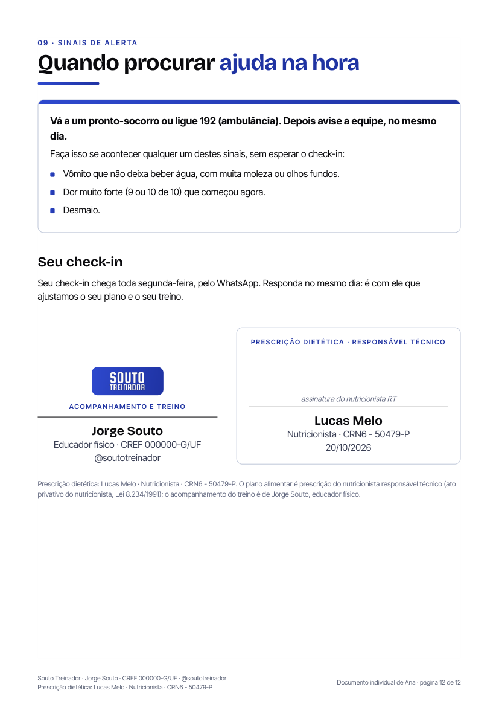

# Guia 05 · Dieta com Responsável Técnico e Painel ST

Este guia leva você do zero até o sistema funcionando: o banco de dados no **Supabase**, os formulários no **Tally**, o **Painel ST** no seu computador e o fluxo da **dieta com aprovação do RT**. Vá na ordem. Cada passo diz **o que fazer**, **como saber que deu certo** e **o que fazer se der errado**.

> **Tempo:** cerca de 2 a 3 horas na primeira vez (com calma). Depois, o dia a dia é abrir o painel e clicar.
>
> **Antes de tudo, leia as 3 regras de ouro:**
> 1. **Chave secreta e dado de aluno nunca vão para o GitHub, para o WhatsApp, para e-mail ou para print.** Este repositório é **público**.
> 2. **Dieta é do nutricionista.** Prescrição dietética é ato privativo do nutricionista (Lei 8.234/1991). Na sua consultoria, o **Responsável Técnico (RT)** pela dieta é **Lucas Melo, Nutricionista, CRN6 - 50479-P**. Nenhum plano alimentar vai para um aluno sem a **APROVAÇÃO DO RT** (o sistema trava).
> 3. **Na dúvida, pare e pergunte.** Nada aqui precisa ser feito com pressa.

---

## Sumário
1. [Como o sistema funciona (visão geral)](#1-como-o-sistema-funciona-visão-geral)
2. [O que você precisa ter](#2-o-que-você-precisa-ter)
3. [Criar a conta e o projeto no Supabase](#3-criar-a-conta-e-o-projeto-no-supabase)
4. [Criar o banco (rodar a migração)](#4-criar-o-banco-rodar-a-migração)
5. [Pegar o endereço e a chave do projeto e guardar no lugar certo](#5-pegar-o-endereço-e-a-chave-do-projeto-e-guardar-no-lugar-certo)
6. [Conferir o "armário" dos PDFs (bucket)](#6-conferir-o-armário-dos-pdfs-bucket)
7. [Publicar a função que recebe os formulários do Tally](#7-publicar-a-função-que-recebe-os-formulários-do-tally)
8. [Criar os formulários no Tally e ligar ao Supabase](#8-criar-os-formulários-no-tally-e-ligar-ao-supabase)
9. [Instalar o Python e abrir o Painel ST](#9-instalar-o-python-e-abrir-o-painel-st)
10. [A assinatura do RT e o PIN do RT](#10-a-assinatura-do-rt-e-o-pin-do-rt)
11. [Uso no dia a dia](#11-uso-no-dia-a-dia)
12. [O fluxo da dieta (/montar-dieta) com a aprovação do RT](#12-o-fluxo-da-dieta-montar-dieta-com-a-aprovação-do-rt)
13. [Onde ficam os PDFs e os arquivos](#13-onde-ficam-os-pdfs-e-os-arquivos)
14. [Cópia de segurança (backup) e exportação](#14-cópia-de-segurança-backup-e-exportação)
15. [LGPD: o que você precisa cumprir](#15-lgpd-o-que-você-precisa-cumprir)
16. [Problemas comuns (FAQ)](#16-problemas-comuns-faq)
17. [Boas práticas](#17-boas-práticas)
18. [Anexo: arquivos, comandos e prints](#18-anexo-arquivos-comandos-e-prints)

---

## 1. Como o sistema funciona (visão geral)

```
 ALUNO                         NUVEM (Supabase, servidor em São Paulo)              SEU PC
 ─────                         ───────────────────────────────────────              ──────
 responde o formulário   ──►   função "tally-webhook" confere a assinatura   ──►   Painel ST (só no seu PC)
 do Tally (anamnese,            do Tally e grava no banco                          lê e grava no banco
 check-in, cargas)                                                                 com a chave secreta
                               banco (tabelas com segurança ligada)          ◄──   agente de dieta (/montar-dieta)
                               "armário" privado dos PDFs (bucket)                 gera o PDF e salva
```

- **Supabase** é o banco de dados na nuvem (um "Excel muito seguro"). Ele guarda alunos, check-ins, cargas, dietas, entregas, agenda, leads e financeiro.
- **Tally** é onde o aluno responde os formulários. Cada resposta vai **sozinha** para o Supabase, mesmo com o seu PC desligado.
- **Painel ST** é o seu painel. Roda **só no seu computador** (endereço `127.0.0.1`, que ninguém de fora acessa) e conversa com o Supabase.
- **O RT (nutricionista)** aprova cada dieta antes do envio. O caminho de uma dieta é sempre:

```
RASCUNHO ──(você revisa)──► APROVAÇÃO DO RT ──(o RT aprova)──► ENVIAR ──(você manda no WhatsApp)──► ENVIADO
                                   │
                                   └──(o RT devolve com nota)──► RASCUNHO (refazer)
```

> Treino e outras entregas que não são de nutrição pulam a etapa do RT: RASCUNHO → ENVIAR → ENVIADO.

---

## 2. O que você precisa ter
- Um computador com **Windows 10 ou 11** e o **Google Chrome** instalado (https://www.google.com/chrome/).
- Um **e-mail** só seu (de preferência o profissional) e um **gerenciador de senhas** (o do Chrome serve; Bitwarden ou 1Password são melhores).
- **Celular** à mão (para a confirmação em duas etapas).
- Esta pasta do projeto no seu PC (`souto-treinador`).
- Do RT: a **imagem da assinatura** dele (passo 10) e, se ele quiser, um **PIN** de aprovação.

> **Custos:** o plano grátis do Supabase e do Tally dá para começar. Atenção: no plano grátis, o Supabase **pausa** o projeto depois de cerca de 1 semana sem nenhum acesso. Com o painel em uso e alunos respondendo formulários, isso não acontece; se acontecer, é só entrar no site e clicar em "Restore" (FAQ 6). Quando a consultoria crescer, o plano pago (Pro) traz backup diário automático.

---

## 3. Criar a conta e o projeto no Supabase

1. Abra **https://supabase.com** e clique em **Start your project** (ou "Sign up").
2. Crie a conta **você mesmo**, com o seu e-mail (ou "Continue with GitHub", se já tiver GitHub). **Você cria e guarda a senha**; ninguém (nem o Claude) deve digitar a sua senha por você.
   - Confirme o e-mail que o Supabase manda.
   - **Ligue a verificação em duas etapas (2FA):** clique na sua foto (canto) → **Account** / **Account preferences** → **Security** / **Multi-factor authentication** → siga o passo a passo com o app autenticador do celular.
3. Se pedir uma **organização**, crie uma: nome `Souto Treinador`, tipo "Personal", plano **Free**.
4. Clique em **New project** e preencha:
   - **Name:** `souto-treinador`
   - **Database Password:** clique em **Generate a password** e **salve no gerenciador de senhas** com o nome "Supabase · senha do banco". Você quase nunca vai usar, mas não pode perder.
   - **Region:** **South America (São Paulo)**. Importante: os dados dos alunos ficam no Brasil (ajuda na LGPD).
   - **Plan:** Free.
5. Clique em **Create new project** e espere 1 a 3 minutos até aparecer o painel do projeto.

**Deu certo se:** você vê o painel do projeto com o menu à esquerda (Table Editor, SQL Editor, Storage, Edge Functions, Authentication, Project Settings).

---

## 4. Criar o banco (rodar a migração)

"Migração" é um arquivo com as instruções que criam todas as tabelas, as travas e a segurança. Você vai copiar e colar.

### Caminho A (recomendado): pelo SQL Editor do site
1. No seu PC, abra a pasta `souto-treinador\06 - GESTÃO DA CONSULTORIA\supabase\migrations`.
2. Clique com o botão direito em **`0001_schema.sql`** → **Abrir com** → **Bloco de Notas**.
3. Aperte **Ctrl+A** (selecionar tudo) e **Ctrl+C** (copiar).
4. No site do Supabase, menu à esquerda → **SQL Editor** → **New query** (ou "+").
5. Clique na área de texto, aperte **Ctrl+V** (colar) e clique em **Run** (ou Ctrl+Enter).
6. Espere. **Deu certo se** aparecer "Success. No rows returned" (sucesso, nenhuma linha devolvida).
7. Confira: menu → **Table Editor**. Devem aparecer as tabelas `alunos`, `checkins`, `dietas`, `entregas`, `aprovacoes_rt`, `lembretes`, `leads`, `pagamentos` e outras (32 ao todo).

> **Rode a migração uma vez só.** Se rodar de novo, aparece erro de "already exists" (já existe). Isso não estraga nada, mas também não refaz nada.
>
> **Deu erro no meio?** Como o arquivo roda dentro de uma "transação" (`begin ... commit`), um erro desfaz tudo e nada fica pela metade. Copie a mensagem de erro (sem dado de aluno, ainda não há) e peça ajuda numa sessão do Claude: "deu este erro na migração 0001".

### Dados fictícios para treinar (opcional, **só num projeto de teste**)
Se quiser ver o sistema cheio antes de usar de verdade, crie **um segundo projeto** (ex.: `souto-treinador-teste`), rode a migração nele e depois cole e rode `supabase\seed_ficticio.sql` do mesmo jeito. São 6 alunos inventados ("Ana Exemplo", "Bruno Fictício"...). **Não rode o seed no projeto de verdade.** (Se rodou sem querer, o fim do arquivo tem um bloco "limpar" que apaga só os fictícios.)

### Caminho B (opcional): pela linha de comando
Só se você já usa o terminal. Precisa do Node.js LTS (https://nodejs.org).
```powershell
cd "C:\caminho\para\souto-treinador\06 - GESTÃO DA CONSULTORIA"
npx supabase login
npx supabase init            # cria supabase\config.toml (sem segredos); se perguntar sobre VS Code, responda N
npx supabase link --project-ref SEU_REF
npx supabase db push
```
`SEU_REF` é o código do projeto: o pedaço do endereço `https://SEU_REF.supabase.co` (passo 5).

---

## 5. Pegar o endereço e a chave do projeto e guardar no lugar certo

O Painel ST precisa de duas informações: o **endereço** do projeto e a **chave secreta** (service_role).

### 5.1 O que é cada chave (leia antes)
| Chave | Para que serve | Pode mostrar? |
|---|---|---|
| **Project URL** (`https://xxxx.supabase.co`) | o endereço do projeto | pode (não é segredo) |
| **anon / publishable** | acesso "público" (navegador, app). No nosso banco ela **não lê nada** (a segurança bloqueia) | não precisa usar |
| **service_role / secret** | **chave-mestra**: passa por cima de toda a segurança e lê os dados de saúde de todos os alunos | **NUNCA**. Só no arquivo privado do seu PC |

> **Por que a service_role é tão perigosa:** quem tiver essa chave lê e apaga **tudo**: nomes, telefones, pesos, exames, dietas. Se ela vazar (print, WhatsApp, GitHub, e-mail), é um **incidente de segurança com dado de saúde** (LGPD). Por isso ela fica só num arquivo fora do projeto, e o `.gitignore` impede que ela suba para o GitHub.

### 5.2 Copiar do site
1. Menu → **Project Settings** (engrenagem) → **API** (em algumas versões: **Data API** para o endereço e **API Keys** para as chaves).
2. Copie o **Project URL** (algo como `https://abcdefghijklm.supabase.co`).
3. Na parte de chaves, use **uma** destas:
   - aba **Legacy API keys** → **service_role** → **Reveal** → copiar (começa com `eyJ...`); **ou**
   - aba **API Keys** → **Secret keys** → copiar (começa com `sb_secret_...`).
   As duas funcionam no Painel ST.

### 5.3 Guardar no arquivo privado
1. Aperte a tecla **Windows**, digite **PowerShell** e abra o **Windows PowerShell**.
2. Copie e cole esta linha e aperte Enter (cria a pasta privada e abre o Bloco de Notas):
   ```powershell
   New-Item -ItemType Directory -Force "$env:USERPROFILE\SoutoTreinador\privado" | Out-Null; notepad "$env:USERPROFILE\SoutoTreinador\privado\supabase.env"
   ```
3. O Bloco de Notas pergunta se quer criar o arquivo: **Sim**.
4. Escreva exatamente assim, trocando pelos seus valores (sem aspas, sem espaço antes ou depois do `=`):
   ```
   SUPABASE_URL=https://SEU_REF.supabase.co
   SUPABASE_SERVICE_ROLE_KEY=cole_aqui_a_chave_secreta
   SUPABASE_BUCKET=entregas
   ```
5. **Arquivo → Salvar** (Ctrl+S). Feche.
6. Confira o nome: abra a pasta (`Windows + R` → cole `%USERPROFILE%\SoutoTreinador\privado` → Enter). O arquivo deve se chamar **`supabase.env`**, e **não** `supabase.env.txt`. Se aparecer `.txt`, renomeie (no Explorador: Exibir → marque "Extensões de nomes de arquivos").

> **Esta pasta (`%USERPROFILE%\SoutoTreinador\privado`) é o cofre.** Fica fora do OneDrive e fora do projeto. Não compartilhe, não sincronize com a nuvem, não mande por WhatsApp.
>
> **Se a chave vazar:** no Supabase, **Project Settings → API Keys**: para a secret key, **revogue/crie outra**; para a legacy, use **"Generate a new JWT secret"** (as chaves antigas param de funcionar). Depois atualize o `supabase.env` e o segredo da função (passo 7). Avise o RT e, se houver risco aos alunos, veja a seção 15.

---

## 6. Conferir o "armário" dos PDFs (bucket)

A migração já cria um **bucket privado** chamado `entregas` (é onde ficam os PDFs das dietas). Só confira:
1. Menu → **Storage**. Deve aparecer **`entregas`**, com o selo **Private** (privado), não "Public".
2. **Se não aparecer:** clique em **New bucket** → Name `entregas` → **deixe "Public bucket" DESLIGADO** → (se houver) limite de tamanho **50 MB** e tipos `application/pdf, application/json` → **Create**.

> **Privado** quer dizer: ninguém abre um PDF pelo endereço. O Painel ST abre por um **link assinado** que vale 10 minutos.

---

## 7. Publicar a função que recebe os formulários do Tally

A "função" (Edge Function) é um pequeno programa que fica no Supabase, recebe cada resposta do Tally, **confere que veio mesmo do Tally** (assinatura secreta) e grava no banco.

### 7.1 Crie o segredo do Tally
É uma senha longa, que só o Tally e o Supabase vão conhecer. No PowerShell, cole e aperte Enter:
```powershell
-join ((48..57)+(65..90)+(97..122) | Get-Random -Count 40 | ForEach-Object {[char]$_})
```
Copie o resultado (40 letras e números) e **guarde no gerenciador de senhas** como "Tally · signing secret".

### 7.2 Caminho A (recomendado): pelo site
1. Menu → **Edge Functions** → **Deploy a new function** → **Via Editor** (editor no navegador).
2. **Nome da função:** `tally-webhook` (exatamente assim).
3. Apague o código de exemplo. No seu PC, abra `06 - GESTÃO DA CONSULTORIA\supabase\functions\tally-webhook\index.ts` com o Bloco de Notas, **Ctrl+A**, **Ctrl+C**, e cole no editor do site.
4. Clique em **Deploy function** e espere terminar.
5. **Desligue a verificação de JWT** (o Tally não faz login no Supabase; quem protege é a assinatura): abra a função → **Details** ou **Settings** → desligue **"Enforce JWT Verification"** / **"Verify JWT"** → **Save**.
6. **Cadastre o segredo:** menu **Edge Functions** → **Secrets** (ou Project Settings → Edge Functions → Secrets) → **Add new secret**:
   - Name: `TALLY_SIGNING_SECRET`
   - Value: o segredo do passo 7.1
   - **Save**.
   (`SUPABASE_URL` e `SUPABASE_SERVICE_ROLE_KEY` já existem lá dentro; não precisa criar.)
7. Anote o **endereço da função**: `https://SEU_REF.supabase.co/functions/v1/tally-webhook`

### 7.3 Caminho B (opcional): pela linha de comando
```powershell
cd "C:\caminho\para\souto-treinador\06 - GESTÃO DA CONSULTORIA"
npx supabase login
npx supabase link --project-ref SEU_REF
npx supabase functions deploy tally-webhook --no-verify-jwt
npx supabase secrets set TALLY_SIGNING_SECRET=O_SEGREDO_DO_PASSO_7_1
```

**Deu certo se:** em Edge Functions aparece `tally-webhook` com status ativo. (Se você abrir o endereço no navegador, ele responde "use POST": está certo, quem fala com ela é o Tally.)

> **Segurança da função:** sem o segredo certo, ela recusa tudo (erro 401). A mesma resposta enviada duas vezes não é gravada em dobro. Se algo der errado no meio, ela desfaz e o Tally tenta de novo mais tarde.

---

## 8. Criar os formulários no Tally e ligar ao Supabase

### 8.1 Conta
1. Abra **https://tally.so** → **Sign up** → crie a conta **você mesmo** (e ligue a 2FA em Settings, se disponível).

### 8.2 Regras que valem para todos os formulários
- **Campo escondido `aluno_id`** (obrigatório em todos): dentro do formulário, digite `/` e escolha **Hidden fields** → nome: `aluno_id`. Ele vem do link que você manda para cada aluno: `https://tally.so/r/CODIGO_DO_FORM?aluno_id=AL-3` (o **código AL-n** do aluno aparece na ficha dele no Painel ST).
- **Os títulos das perguntas abaixo precisam ser escritos como estão** (pode ter texto de ajuda embaixo). É pelo título que a função sabe onde gravar cada resposta. Acento e maiúscula não importam; o começo do título, sim.
- Perguntas a mais que você quiser criar **não se perdem**: tudo vai, em texto, para a tabela `recebidos` (e aparece em "Recebidos para analisar").
- Não peça dado que você não vai usar (LGPD: o mínimo necessário).
- As perguntas vieram dos formulários do sistema anterior, adaptadas para alunos de treino. As **perguntas clínicas de nutrição** (intestino, exames, histórico de dietas) são para o RT: combine com ele quais manter.

### 8.3 Formulário 1 · Anamnese (`?tipo=anamnese`)
| Título da pergunta (começa assim) | Tipo no Tally | Vai para |
|---|---|---|
| Nome completo | Short answer (obrigatória) | ficha: nome |
| Como prefere ser chamado(a)? | Short answer | ficha: primeiro nome |
| Data de nascimento | Date | ficha |
| Sexo biológico | Multiple choice: Feminino / Masculino | ficha (para os cálculos) |
| Altura em centímetros | Number | ficha |
| Peso atual, de preferência em jejum | Number | recebidos (texto) |
| WhatsApp | Phone number | ficha: telefone |
| E-mail | Email | ficha |
| Cidade e estado | Short answer | ficha |
| Profissão / Como é sua jornada de trabalho | Long answer | texto (para o RT e para o fator de atividade) |
| Atividade física: modalidades, dias, duração | Long answer | texto |
| Lesões, dores ou limitações para treinar | Long answer | texto |
| Remédios de uso contínuo / Suplementos em uso | Long answer | texto |
| Alergias e intolerâncias | Long answer | texto |
| Alimentos que você não come | Long answer | texto |
| Descreva sua alimentação de um dia comum | Long answer | texto |
| Sono: horas por noite / Estresse no dia a dia | Number / Linear scale 0-10 | texto |
| Quais são seus maiores objetivos? | Long answer | texto |
| Fotos de frente, lado e costas (opcional) | File upload | texto (link) |
| **Li e aceito o termo de consentimento** | Checkboxes com 1 opção: "Sim, li e aceito o termo de consentimento" (obrigatória) | ficha: data do aceite (LGPD) |

- Coloque **antes** da última pergunta um bloco de texto com o **termo de consentimento** (seção 15) ou o link para ele.
- **Sem `aluno_id` no link** (aluno novo): a função **cria a ficha** sozinha, com status "entrada". Com `aluno_id`, ela **só completa** o que está vazio na ficha (não apaga o que você corrigiu).

### 8.4 Formulário 2 · Check-in semanal (`?tipo=checkin`)
| Título da pergunta (começa assim) | Tipo no Tally | Vai para |
|---|---|---|
| Peso em jejum (kg) | Number (aceita vírgula) | check-in e medidas (se houver mais de uma pesagem, crie "Peso 2 (kg)", "Peso 3 (kg)": a função tira a média) |
| Dias seguindo o plano alimentar (0 a 7) | Number 0-7 | dias no plano (para quem tem dieta) |
| Dias em que saiu um pouco do plano | Number 0-7 | dias leves |
| Dias em que saiu bastante do plano | Number 0-7 | dias fora |
| Treinos feitos na semana | Number | treinos |
| Fome (0 a 10) | Linear scale 0-10 | fome |
| Saciedade (0 a 10) | Linear scale 0-10 | saciedade |
| Sono: horas por noite | Number | sono |
| Sono: qualidade (0 a 10) | Linear scale 0-10 | sono |
| Estresse (0 a 10) | Linear scale 0-10 | estresse |
| Água por dia (litros) | Number | água |
| Cintura (cm) | Number (opcional) | medidas |
| Quadril (cm) | Number (opcional) | medidas |
| Teve dor ou lesão nova? | Multiple choice: Sim / Não | se "Sim": nível "revisar" + lembrete "para hoje" |
| Algum destes sinais? | Checkboxes: Desmaio · Dor no peito · Falta de ar fora do normal · Vômito que não deixa beber água · Nenhum | se marcar qualquer um que não seja "Nenhum": **lembrete URGENTE** no painel |
| Alguma troca que você quer pedir no plano? | Long answer | troca pedida |
| Qual foi a maior dificuldade da semana? | Long answer | dificuldade |
| Sua pergunta | Long answer | pergunta |

- **Alerta na tela do aluno:** no Tally, use uma regra (Logic) para, se marcar algum sinal de alerta, mostrar a mensagem: "Vá a um pronto-socorro ou ligue 192. Depois nos avise." O painel avisa você, mas **não liga para ninguém**.
- A "semana" do check-in é a segunda-feira da semana da resposta. Se quiser, mande também o campo escondido `semana_inicio` (AAAA-MM-DD).

### 8.5 Formulário 3 · Check-in de cargas (`?tipo=cargas`) · o gráfico de cargas da ficha
| Título da pergunta (começa assim) | Tipo no Tally |
|---|---|
| Quais treinos você fez nesta semana? | Checkboxes: Treino A · Treino B · Treino C (até F) |
| `A · Agachamento livre · carga (kg)` | Number (vírgula aceita) |
| `A · Agachamento livre · repetições` | Short answer, ex.: "10 9 8" (uma série por número) |
| (repita as duas linhas para cada exercício: letra do treino · nome do exercício) | |
| `B · Barra fixa · repetições` | exercício de peso do corpo: só as repetições |
| Esforço da semana (0 a 10) | Linear scale 0-10 |
| Dor durante o treino (0 a 10) | Linear scale 0-10 (5 ou mais gera lembrete) |
| Recado | Long answer |

- A função cria a **semana de treino**, uma **sessão** por treino marcado e uma **série** por exercício preenchido. Na ficha do aluno, "Cargas do treino" mostra a maior carga de cada semana (ou o total de repetições, nos de peso do corpo).
- Use o **mesmo nome de exercício** toda semana (é por ele que o gráfico junta os pontos).
- Dica: monte um formulário de cargas por aluno (duplique e troque os exercícios) e guarde o link na ficha.

### 8.6 (Opcional) Anamnese de treino (`?tipo=anamnese_treino`)
Para PAR-Q+ e histórico de treino. Use o **texto oficial do PAR-Q+** (https://eparmedx.com), sem mudar as palavras. Vai inteiro para "Recebidos".

### 8.7 Ligar cada formulário ao Supabase (webhook)
Para **cada** formulário:
1. Abra o formulário no Tally → **Integrations** → **Webhooks** → **Connect**.
2. **Endpoint URL:** o endereço da função + o tipo:
   - anamnese: `https://SEU_REF.supabase.co/functions/v1/tally-webhook?tipo=anamnese`
   - check-in semanal: `...tally-webhook?tipo=checkin`
   - check-in de cargas: `...tally-webhook?tipo=cargas`
   - anamnese de treino: `...tally-webhook?tipo=anamnese_treino`
3. **Signing secret:** cole o segredo do passo 7.1 (**o mesmo** nos quatro formulários).
4. Não precisa de "HTTP headers". Salve (**Connect**).
5. **Publique** o formulário (botão Publish).

### 8.8 Testar
1. Abra o link do check-in com um aluno de teste: `https://tally.so/r/CODIGO?aluno_id=AL-1` e responda com dados inventados.
2. No Tally, em **Integrations → Webhooks**, veja o histórico: deve aparecer **200** (verde).
3. No Supabase, **Table Editor → recebidos**: aparece uma linha nova. Em `checkins` e `medidas`, também.
4. No Painel ST (passo 9), a resposta aparece em **Hoje → Recebidos para analisar**.
5. Apague as linhas de teste (Table Editor → selecione → Delete) antes de começar com alunos de verdade.

| Código no histórico do Tally | Quer dizer | O que fazer |
|---|---|---|
| 200 | gravou | nada |
| 401 | assinatura inválida | o segredo do Tally e o `TALLY_SIGNING_SECRET` não são iguais (refaça os dois) |
| 500 | a função não conseguiu gravar | veja Edge Functions → tally-webhook → **Logs**; o Tally tenta de novo sozinho |
| 404 | endereço errado | confira o nome `tally-webhook` e o `SEU_REF` |

---

## 9. Instalar o Python e abrir o Painel ST

### 9.1 Python (uma vez)
1. Abra **https://www.python.org/downloads/** e baixe o **Python 3.12** (ou mais novo) para Windows.
2. Na primeira tela do instalador, **marque "Add python.exe to PATH"** e clique em **Install Now**.
3. Confira: abra o PowerShell e digite `python --version` → deve aparecer `Python 3.12...`.
4. (Opcional) Pacotes extras: o painel e o agente usam **só o que já vem com o Python**. Para contar páginas de PDF com mais precisão, na pasta `06 - GESTÃO DA CONSULTORIA` rode:
   ```powershell
   python -m pip install -r requirements.txt
   ```

### 9.2 Ver a demonstração primeiro (sem Supabase, dados inventados)
1. Abra a pasta `06 - GESTÃO DA CONSULTORIA\Painel ST`.
2. Clique com o botão direito em **`criar_atalho.ps1`** → **Executar com o PowerShell**.
   - Se o Windows bloquear ("execução de scripts desabilitada"), abra o PowerShell **nesta pasta** (Shift + botão direito no espaço vazio → "Abrir janela do PowerShell aqui") e rode:
     ```powershell
     powershell -ExecutionPolicy Bypass -File .\criar_atalho.ps1 -Demo
     ```
3. Aparecem na área de trabalho **Painel ST** e **Painel ST (demonstracao)**. Abra a demonstração: o painel aparece com o selo amarelo **DEMONSTRAÇÃO · dados fictícios**. Clique à vontade: nada é gravado.

### 9.3 Abrir de verdade
1. Com o `supabase.env` pronto (passo 5), dê duplo clique em **Painel ST**.
2. Ele abre numa janela própria. Vá em **Sistema**: deve mostrar **Supabase · conectado** (bolinha verde).
3. **Fixar na barra de tarefas:** com o painel aberto, botão direito no ícone ST da barra → **Fixar**.
4. **Fechar:** feche a janela. O painel desliga sozinho em cerca de 1,5 min.

### 9.4 Cadastrar o primeiro aluno
Hoje, o cadastro entra de dois jeitos: (a) pela **anamnese do Tally sem `aluno_id`** (a ficha nasce sozinha); ou (b) no Supabase, **Table Editor → alunos → Insert row** (preencha `nome`, `telefone` com DDI e DDD só números, ex. `5584999998888`, `linha`, `status`, `tem_dieta`, `tem_treino`, `dia_checkin`). O **código AL-n** é criado sozinho.

---

## 10. A assinatura do RT e o PIN do RT

### 10.1 A imagem da assinatura (obrigatória para enviar dieta)
O PDF da dieta termina com o bloco **"Prescrição dietética · Responsável Técnico"**: o nome **Lucas Melo · Nutricionista · CRN6 - 50479-P** e a **imagem da assinatura dele**.
1. O **RT** assina numa folha branca com caneta preta ou azul-escura, fotografa ou escaneia bem iluminado e recorta só a assinatura.
2. Ideal: PNG com **fundo transparente**, cerca de 600 × 180 pixels. Com fundo branco também funciona.
3. **O próprio RT** (ou você, recebendo dele por um canal seguro) salva o arquivo como:
   `%USERPROFILE%\SoutoTreinador\privado\assinatura-rt.png`
4. Confira em **Painel ST → Sistema**: "assinatura do RT · encontrada".

> **A assinatura nunca vai para o repositório nem para nuvem pública.** O `.gitignore` bloqueia `assinatura*.png`. Sem a imagem, o PDF sai com a linha "assinatura do nutricionista RT" e o agente **se recusa a salvar** a dieta para envio. Nunca desenhe, copie ou "fabrique" a assinatura de ninguém.

### 10.2 O PIN do RT (recomendado)
Com o PIN ligado, os botões **"Aprovar como RT"** e **"Devolver com nota"** pedem um número que **só o RT sabe**.
1. Com o RT ao seu lado (ou em chamada com compartilhamento de tela), abra o PowerShell na pasta `Painel ST` e rode:
   ```powershell
   python painel_st.py --definir-pin-rt
   ```
2. **O RT digita** o PIN (4 a 12 números) duas vezes. Nada aparece na tela; só uma "impressão digital" do PIN (SHA-256) vai para o `supabase.env`.
3. Feche e abra o painel. Em **Sistema**: "PIN do RT · ligado".

> **Cada decisão do RT fica registrada** (tabela `aprovacoes_rt`): quem, quando e a impressão digital do PDF aprovado. Se o PDF for trocado depois da aprovação, a entrega volta sozinha para o RT.
>
> **Como o RT aprova se não está no seu PC?** Opções, da mais simples à mais independente: (1) em chamada, o RT confere o PDF e digita o PIN dele no seu painel (compartilhando a tela); (2) presencialmente; (3) o RT instala o Painel ST no PC dele com um `supabase.env` próprio (combine com ele; quanto menos cópias da chave secreta, melhor). O RT também pode ter login próprio no Supabase (Authentication → Add user, e uma linha na tabela `equipe` com o papel `rt`); com login, só quem tem o papel `rt` consegue aprovar dieta.

---

## 11. Uso no dia a dia

**Toda manhã (10 minutos):**
1. Abra o **Painel ST**.
2. **Início:** o card grande mostra o que é **urgente** (ou o próximo horário). Os números mostram quantos itens esperam aprovação e quantos estão **com o RT**.
3. **Hoje:** lembretes por seção (Urgente, Para hoje, Próximos dias). Fez? Toque em **Feito**. À direita, os **recebidos** (check-ins, anamneses, cargas) para analisar.
4. **Aprovações:** revise o que está em RASCUNHO, o que o RT já aprovou (ENVIAR) e as mensagens.
5. **Alunos → ficha:** peso em gráfico, **cargas do treino** (escolha o exercício), check-ins, planos, entregas, lembretes e diário. A ficha avisa **"falta o termo LGPD"** se o aluno ainda não aceitou.

**Mandar uma entrega pelo WhatsApp (status ENVIAR):**
1. **1 · Abrir no WhatsApp:** abre a conversa com o texto pronto (o texto também fica copiado: se não aparecer, aperte Ctrl+V).
2. **2 · Abrir na pasta:** abre o Explorador com o PDF selecionado: **arraste para a conversa**. (Ou **Copiar PDF** e Ctrl+V na conversa.)
3. Mande e toque em **Marcar enviado** (pede "Confirmar?": toque de novo).

**Regras dos botões:** toda ação pede um **segundo toque** ("Confirmar?"). Se uma transição não for permitida (ex.: enviar dieta sem o RT), o painel não faz nada e explica por quê.

---

## 12. O fluxo da dieta (/montar-dieta) com a aprovação do RT

Quem monta o plano é o agente de dieta, numa sessão do **Claude Code** aberta na pasta do projeto, com o **método do RT** (`Agente de dieta/Método do RT (Lucas Melo).md`). As decisões clínicas (números, fase, cortes, suplementos) **são do RT**.

1. Na sessão do Claude, diga: **"/montar-dieta Ana Exemplo"** (troque pelo nome do aluno).
2. O agente lê o aluno no Supabase (anamnese, check-ins, medidas, cargas, dieta em uso) e mostra um resumo.
3. **Parada 1 (números):** gasto do dia, fase, calorias, proteína, gordura, carboidrato, água, refeição livre, suplementos. **O RT confirma ou ajusta.**
4. **Parada 2 (cardápio):** refeições com 3 a 4 opções de troca, conferidas pela tabela TACO/TBCA. **O RT confirma ou ajusta.**
5. O agente gera o **PDF na sua marca** (capa azul com o logo, rodapé "Souto Treinador · Jorge Souto · CREF … · @…" e "Prescrição dietética: Lucas Melo · Nutricionista · CRN6 - 50479-P", bloco de assinatura do RT no fim) e salva no Supabase como **RASCUNHO**.
6. **No Painel ST → Aprovações:**
   - você abre o PDF (**Ver PDF**), confere a linguagem e toca em **"Revisado: mandar para o RT"** → status **APROVAÇÃO DO RT**;
   - o **RT** abre o PDF, confere e toca em **"Aprovar como RT"** (com o PIN) → status **ENVIAR**; ou **"Devolver com nota"** (escreve o que mudar) → volta para RASCUNHO e o agente refaz (`salvar --refazer`);
   - você manda pelo WhatsApp (seção 11) e toca em **Marcar enviado** → **ENVIADO**. A "dieta em uso" do aluno troca sozinha e o plano anterior é fechado.
7. **Modelo A ou B:** o A (claro) é melhor para imprimir; o B (escuro) é melhor no celular. A escolha fica na ficha do aluno (`modelo_pdf`).

> **Travas que você não precisa lembrar (o sistema lembra):** dieta não vai para ENVIAR sem o RT; PDF trocado depois da aprovação volta para o RT; dieta abaixo de 800 kcal só com justificativa escrita do RT; PDF sem a imagem da assinatura não é salvo para envio.

---

## 13. Onde ficam os PDFs e os arquivos

| O quê | Onde | Vai para o GitHub? |
|---|---|---|
| PDF, HTML e JSON de cada plano, pacote do aluno | `%USERPROFILE%\SoutoTreinador\Alunos\<nome do aluno>\` | **Nunca** |
| PDFs de treino | `%USERPROFILE%\SoutoTreinador\Alunos\<nome do aluno>\Treino\` | **Nunca** |
| Cópia do PDF e do JSON na nuvem | Supabase → Storage → `entregas` (privado) → `alunos/<id>/` | **Nunca** |
| Chave do Supabase, assinatura do RT, contato do prescritor | `%USERPROFILE%\SoutoTreinador\privado\` | **Nunca** |
| Código, modelos, banco de alimentos, exemplo fictício | `souto-treinador\06 - GESTÃO DA CONSULTORIA\` | sim |

- `%USERPROFILE%` é a sua pasta de usuário (ex.: `C:\Users\seu-nome`). Atalho: **Windows + R** → cole `%USERPROFILE%\SoutoTreinador` → Enter.
- Se o PDF não estiver no PC (ex.: PC novo), o painel **baixa do Supabase** na hora de "Abrir na pasta".

---

## 14. Cópia de segurança (backup) e exportação

No plano grátis, o Supabase **não guarda cópias automáticas que você possa restaurar**. Faça a sua:

**Toda semana (5 minutos):**
1. Supabase → **Table Editor** → em cada tabela importante (`alunos`, `checkins`, `medidas`, `dietas`, `entregas`, `aprovacoes_rt`, `pagamentos`, `series`, `sessoes`, `semanas_treino`, `diario`, `lembretes`, `leads`) → botão **Export** → **Export to CSV**.
2. Salve os CSVs numa pasta com a data em `%USERPROFILE%\SoutoTreinador\privado\backup\AAAA-MM-DD\`.
3. **Proteja o backup:** são dados de saúde. Compacte com senha (7-Zip → "Adicionar ao arquivo" → criptografia AES-256) ou mantenha num disco com BitLocker. **Não** suba para Google Drive/OneDrive sem criptografia.
4. Os PDFs já estão nas pastas dos alunos; copie a pasta `%USERPROFILE%\SoutoTreinador\Alunos` junto (também protegida).

**Pela linha de comando (opcional, avançado):** `npx supabase db dump --data-only -f backup.sql` (precisa do Docker Desktop instalado). Guarde o arquivo no mesmo lugar protegido.

**Quando crescer:** o plano **Pro** do Supabase faz backup diário automático (e pode ter recuperação "ponto no tempo").

**Pedido de um aluno ("quero meus dados"):** filtre as tabelas pelo `aluno_id` dele e exporte em CSV (ou peça ajuda numa sessão do Claude: "exportar os dados do aluno AL-n"). Prazo da LGPD: responda em até 15 dias (art. 19).

---

## 15. LGPD: o que você precisa cumprir

> Isto é orientação prática, não parecer jurídico. Para o contrato e o termo finais, consulte um advogado.

- **Dados de saúde são "dados sensíveis"** (LGPD, art. 5º, II): peso, medidas, dores, lesões, exames, dieta, remédios, fotos do corpo. Exigem cuidado redobrado (art. 11).
- **Base legal:** use o **consentimento específico e destacado** do aluno (art. 11, I), por isso a pergunta "Li e aceito o termo de consentimento" na anamnese. A data do aceite fica na ficha (`consentimento_lgpd_em`); o painel avisa quando falta.
- **O termo de consentimento deve dizer, em linguagem simples:**
  1. quem é o controlador (você, Jorge Souto / Souto Treinador) e o contato para assuntos de dados;
  2. quais dados são coletados (os do formulário, check-ins, fotos, cargas, mensagens);
  3. para quê (prescrição e acompanhamento do treino; **plano alimentar prescrito pelo nutricionista RT**, que acessa os dados de saúde para isso);
  4. com quem são compartilhados: o **RT (nutricionista)**; os fornecedores que guardam os dados (**Supabase**, com servidor em São Paulo; **Tally**, que recebe as respostas dos formulários); o WhatsApp (para o envio);
  5. por quanto tempo ficam guardados (o prazo do acompanhamento + o que os conselhos profissionais exigirem para prontuário; confirme com o RT);
  6. os direitos do aluno (art. 18): ver, corrigir, levar, apagar (quando possível) e **revogar o consentimento** a qualquer momento;
  7. como ele pede isso (seu WhatsApp ou e-mail profissional).
- **Minimização:** não peça o que não vai usar. Não guarde CPF se não emitir recibo/nota.
- **Acesso:** só você e o RT. A chave secreta fica só no seu PC (e, se combinado, no do RT). Computador com senha e tela bloqueando sozinha.
- **Fotos:** só com consentimento, nunca em conteúdo/redes, nunca "antes e depois" sem autorização específica por escrito.
- **Incidente (vazamento, PC roubado, chave exposta):** troque a chave (seção 5), avalie o risco e, se houver risco ou dano relevante aos alunos, comunique a **ANPD** e os alunos afetados (art. 48), em prazo curto. Guia oficial: https://www.gov.br/anpd
- **Lei completa:** https://www.planalto.gov.br/ccivil_03/_ato2015-2018/2018/lei/l13709.htm

---

## 16. Problemas comuns (FAQ)

**1. O painel abre e diz "Não deu para carregar · Falta SUPABASE_URL ou SUPABASE_SERVICE_ROLE_KEY".**
O arquivo `supabase.env` não foi achado ou está incompleto. Confira o nome (não pode ser `supabase.env.txt`), o lugar (`%USERPROFILE%\SoutoTreinador\privado\`) e as duas linhas (seção 5.3).

**2. "SUPABASE_URL deve ser o endereço do projeto".**
O endereço precisa ser exatamente `https://SEU_REF.supabase.co`, sem barra no fim e sem `/rest/v1`.

**3. "Supabase 401" ou "Invalid API key".**
A chave está errada, incompleta (copiou faltando um pedaço) ou foi trocada no site. Copie de novo a **service_role/secret** (não a anon/publishable).

**4. "sem conexão com o Supabase".**
Sem internet, ou o projeto está pausado (FAQ 6). Abra o site do Supabase para conferir.

**5. Duplo clique no atalho e nada acontece.**
Abra o PowerShell na pasta `Painel ST` e rode `python painel_st.py`: a mensagem de erro aparece no console. Se disser que não acha o Python, reinstale marcando "Add python.exe to PATH" e rode o `criar_atalho.ps1` de novo.

**6. O Supabase pausou o projeto.**
No plano grátis, depois de cerca de 1 semana sem uso. Entre no site → projeto → **Restore project**. Os dados continuam lá. Nesse tempo, as respostas do Tally falham (o Tally tenta de novo por um tempo; confira o histórico do webhook).

**7. O aluno respondeu o check-in e nada apareceu no painel.**
Toque no botão **atualizar** (setas) do painel. Depois: Tally → Integrations → Webhooks → histórico (seção 8.8). Se for 200 e não aparece com o nome do aluno, o link estava sem `aluno_id` ou com o código errado: veja a resposta em **Hoje → Recebidos** como "sem aluno" (SEM_DONO) e corrija o `aluno_id` na tabela `recebidos` do Supabase.

**8. O webhook do Tally dá 401.**
O "signing secret" do Tally e o `TALLY_SIGNING_SECRET` do Supabase estão diferentes. Copie o mesmo valor nos dois lugares.

**9. O webhook dá 401 mesmo com o segredo certo.**
A verificação de JWT da função ficou ligada. Desligue "Enforce JWT Verification" (seção 7.2, item 5) ou publique com `--no-verify-jwt`.

**10. "nada feito: esta entrega precisa do RT".**
É a trava funcionando: dieta, suplementação e receituário passam pela **APROVAÇÃO DO RT**. Use "Revisado: mandar para o RT" e peça a aprovação.

**11. "PIN do RT incorreto: nada foi aprovado".**
O PIN digitado não confere. Só o RT sabe o PIN. Para trocar, o RT roda `python painel_st.py --definir-pin-rt` de novo.

**12. "O PDF na pasta do aluno é diferente do que foi salvo".**
Alguém abriu e salvou o PDF por cima, ou gerou de novo sem salvar no Supabase. Gere o PDF e rode o `salvar --refazer` (o agente faz isso) para o RT aprovar o arquivo certo.

**13. O PDF saiu com "assinatura do nutricionista RT" no lugar da assinatura.**
Falta a imagem `assinatura-rt.png` na pasta privada (seção 10.1). Ponha a imagem e gere o PDF de novo.

**14. "Chrome não encontrado".**
Instale o Google Chrome. Se ele estiver num lugar diferente, crie a variável `CHROME` com o caminho do `chrome.exe` (Configurações do Windows → "Editar as variáveis de ambiente da sua conta" → Novo → Nome `CHROME`, Valor `C:\...\chrome.exe`).

**15. O WhatsApp abriu, mas o texto não veio.**
O WhatsApp do Windows às vezes descarta o texto do link. O painel já copiou o texto: clique na caixa de mensagem e aperte **Ctrl+V**.

**16. "Abrir na pasta" deu erro.**
O PDF não estava no PC e não deu para baixar do Supabase (internet ou PDF não salvo). Confira em **Storage → entregas** se o arquivo existe.

**17. Rodei a migração duas vezes e deu "already exists".**
Normal: a primeira vez já criou tudo. Não precisa fazer nada.

**18. Quero mudar o CREF, o @ ou o nome que aparece no PDF.**
Edite só o arquivo `06 - GESTÃO DA CONSULTORIA\config-st.json` (os campos com TROCAR). Gere os PDFs de novo.

**19. O painel diz "O painel está desligado".**
A janela ficou aberta e o servidor desligou (por exemplo, depois que o PC dormiu). Feche a janela e abra pelo atalho de novo.

**20. Posso abrir o Painel ST no celular?**
Não: por segurança ele só responde no próprio PC (127.0.0.1). No celular, você usa o WhatsApp e o Tally normalmente.

**21. Apaguei um aluno sem querer.**
Apagar um aluno apaga em cascata check-ins, dietas e entregas dele. Só um backup recupera (seção 14). Prefira mudar o status para "encerrado" em vez de apagar.

---

## 17. Boas práticas
1. **Nunca** mande print do Supabase, do `supabase.env` ou do painel com dado de aluno para ninguém (nem para suporte). Para pedir ajuda, use o modo `--demo`.
2. **Uma chave, um lugar:** a chave secreta mora só no `supabase.env`. Não cole em sessão de chat, e-mail ou documento.
3. **Ligue a 2FA** no Supabase, no Tally, no GitHub e no e-mail.
4. **Bloqueie o PC** ao sair (Windows + L).
5. **Backup semanal** protegido (seção 14), e teste abrir um backup de vez em quando.
6. **Revise antes do RT:** linguagem simples, nome certo do aluno, datas de início e validade.
7. **Nunca mande dieta fora do fluxo** (por exemplo, um PDF antigo editado à mão): o que vale é o PDF aprovado pelo RT.
8. **Mesmo nome de exercício** toda semana no check-in de cargas: o gráfico depende disso.
9. **Status em vez de apagar:** aluno que saiu vira "encerrado"; entrega errada vira "DESCARTADO".
10. **Mudanças no sistema** (novas tabelas, campos): peça ao agente `arquiteto-da-gestao` numa sessão do Claude; ele cria uma nova migração numerada (nunca edita a 0001 depois de aplicada).
11. **Ao trocar de PC:** instale Python e Chrome, copie a pasta `%USERPROFILE%\SoutoTreinador` (protegida) e rode o `criar_atalho.ps1`.
12. **Quando o RT mudar:** atualize o bloco `rt` do `config-st.json`, a imagem da assinatura e o PIN, e registre a data da troca; planos antigos continuam com o RT que os aprovou.

---

## 18. Anexo: arquivos, comandos e prints

**Pastas do projeto (vão para o GitHub):**
```
06 - GESTÃO DA CONSULTORIA/
├── config-st.json                    ← marca, CREF/@ (TROCAR), RT, pastas
├── comum/                            ← configuração e cliente do Supabase
├── Agente de dieta/                  ← dieta: alimentos, contas, PDF, receituário, método do RT
├── Painel ST/                        ← painel_st.py, web/, demo/, criar_atalho.ps1
└── supabase/                         ← migrations/0001_schema.sql, seed_ficticio.sql, functions/tally-webhook/
```

**Pastas no seu PC (NUNCA vão para o GitHub):**
```
%USERPROFILE%\SoutoTreinador\
├── privado\    supabase.env · assinatura-rt.png · prescritor.json (contato do RT) · backup\
└── Alunos\     <nome do aluno>\  (pacote, JSON, PDFs)
```

**Comandos úteis (PowerShell, na pasta indicada):**
| Para | Pasta | Comando |
|---|---|---|
| Criar os atalhos | `Painel ST` | `powershell -ExecutionPolicy Bypass -File .\criar_atalho.ps1 -Demo` |
| Abrir o painel vendo erros | `Painel ST` | `python painel_st.py` |
| Demonstração | `Painel ST` | `python painel_st.py --demo` |
| Definir o PIN do RT | `Painel ST` | `python painel_st.py --definir-pin-rt` |
| Gerar o PDF de exemplo | `Agente de dieta\template` | `python montar_plano.py exemplo-ficticio.json --saida "$env:TEMP\plano-teste"` |
| Regerar os dados fictícios | `supabase` | `python gerar_dados_ficticios.py` |

**Prints (dados fictícios):**
- Painel: `docs/prints/painel/01-inicio.png`, `02-aprovacoes.png` (aprovação do RT aberta), `03-ficha-do-aluno.png` (peso e cargas), `04-hoje.png`, `05-alunos.png`, `06-leads.png`, `07-financeiro.png`, `08-sistema.png`.
- Dieta: `docs/prints/dieta/modelo-a-01-capa.png`, `modelo-a-02-plano-alimentar.png`, `modelo-a-03-assinatura-rt.png` e os mesmos do `modelo-b` (o bloco do RT aparece com a linha "assinatura do nutricionista RT", porque a imagem real nunca vai para o repositório).






