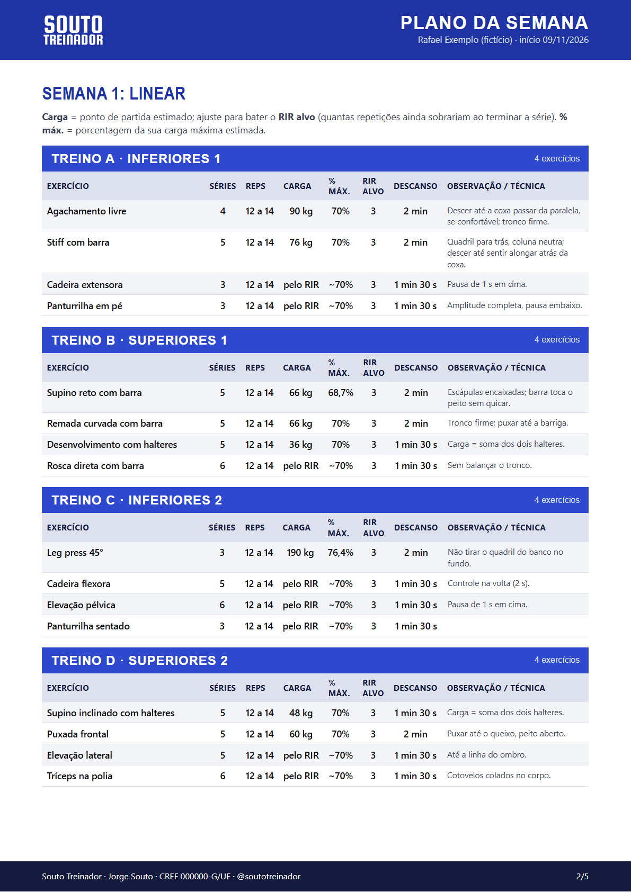
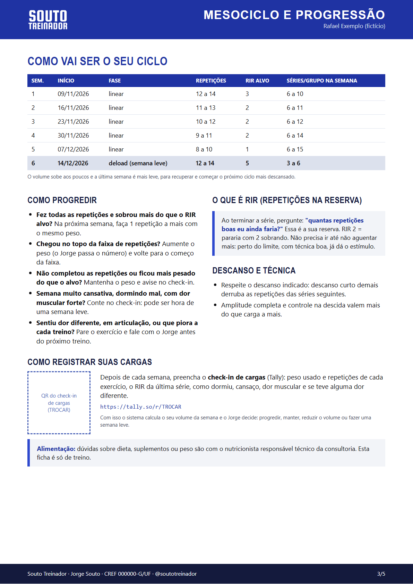
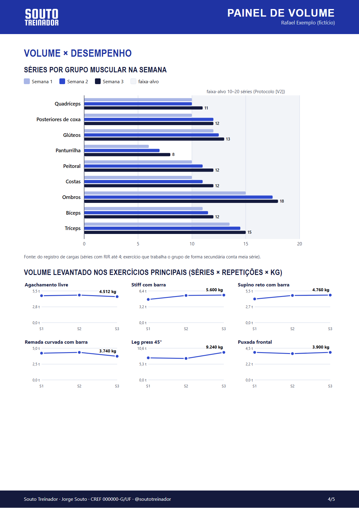
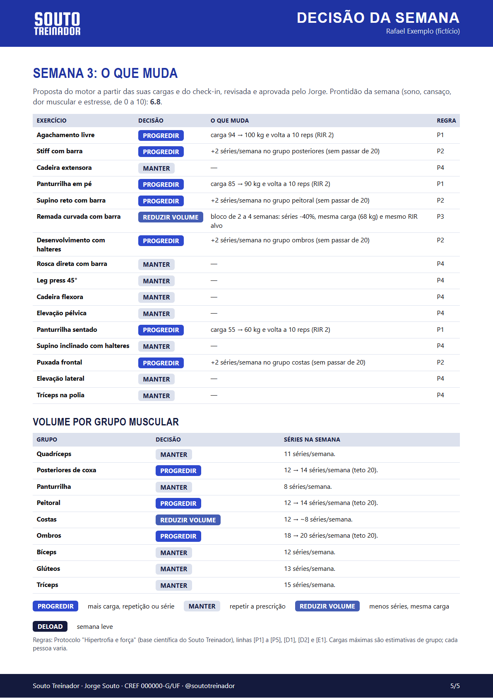

# Guia 06 — Treino: prescrição e controle de volume (passo a passo para quem não programa)

> Para: Jorge Souto (SOUTO TREINADOR) ou quem opera o sistema com ele.
> Sistema: Windows 10/11, PowerShell, Claude Code, Python 3.12 e Google Chrome.
> Tempo: montar o treino de um aluno novo leva de 20 a 40 minutos (a maior parte é conversa e conferência); o acompanhamento semanal leva de 5 a 10 minutos por aluno.

---

## 1. O que o motor de treino faz

O motor de treino é uma "calculadora com regras" que ajuda o Jorge a **prescrever** e a **acompanhar** o treino de força de cada aluno. Ele faz cinco coisas:

| # | O que faz | Em uma frase |
|---|---|---|
| 1 | **Estima a carga máxima (1RM)** | A partir de "fiz 100 kg 8 vezes e sobravam 2", calcula quanto a pessoa provavelmente levantaria uma única vez. |
| 2 | **Monta a tabela de cargas** | Para cada exercício, diz o peso para fazer X repetições deixando Y "sobrando". |
| 3 | **Mede o volume da semana** | Conta as séries de verdade por grupo muscular e o "volume levantado" (séries × repetições × kg). |
| 4 | **Decide a progressão** | Lê as cargas da semana e o check-in (sono, cansaço, dor) e propõe: **PROGREDIR**, **MANTER**, **REDUZIR VOLUME** ou **DELOAD** (semana leve), sempre com o motivo e a regra. |
| 5 | **Gera o mesociclo e a ficha** | Monta 4 a 8 semanas (linear, ondulatória ou em blocos) com o volume subindo aos poucos e uma semana leve no fim, e imprime a ficha do aluno em PDF na identidade azul. |

**O que ele NÃO faz:**
- Não decide sozinho. Tudo o que ele produz é **proposta**: o Jorge aprova (⏸) antes de ir para o aluno ou para o banco.
- Não prescreve dieta, suplemento ou dose. Isso é do nutricionista responsável técnico (RT) da consultoria (Lei 8.234/1991).
- Não substitui o olho do treinador: técnica, dor, contexto de vida e conversa com o aluno continuam sendo do Jorge.

**Por que existe?** Porque a decisão "aumento o peso ou não?" fica muito mais segura quando se olha a **tendência** de algumas semanas (desempenho subindo? cansaço acumulando?) em vez de um treino isolado. E porque cada regra do motor está escrita, com fonte, num documento só: o **Protocolo "Hipertrofia e força"** da base científica.

---

## 2. Onde fica cada coisa

```
souto-treinador/                                  (a raiz do repositório)
├─ 01 - BASE CIENTÍFICA/Treino de força/
│  ├─ Hipertrofia e força - Protocolo.md          as regras, com fonte e grau (o "porquê" de cada decisão)
│  └─ Hipertrofia e força - Ficha.md              frases prontas para conteúdo (roteiro, carrossel)
├─ 05 - TREINO/
│  ├─ CLAUDE.md                                   manual da pasta (para a IA)
│  ├─ calcular_treino.py                          o motor (cálculos e decisões)
│  ├─ montar_ficha.py                             a ficha em PDF
│  ├─ treino_supabase.py                          a ponte com o banco (Painel ST / Tally)
│  └─ exemplo/                                    um aluno FICTÍCIO completo para treinar e testar
├─ .claude/skills/treino/SKILL.md                 o comando /treino
├─ .claude/agents/05-treino/prescritor-de-treino.md   o agente que redige as propostas
└─ docs/guias/06-treino.md                        este guia

FORA do repositório (dados de aluno, LGPD):
%USERPROFILE%\SoutoTreinador\Alunos\<nome do aluno>\Treinos\
      aluno.json · mesociclo-*.json · registro*.json · checkin*.json · decisao-sem*.json · ficha-treino-*.pdf
```

> **Regra de ouro:** nada de aluno real dentro da pasta `souto-treinador`. O repositório vai para o GitHub (público). Os dados do aluno ficam só na pasta `SoutoTreinador\Alunos` do seu usuário e no Supabase.

---

## 3. Pré-requisitos e teste rápido (5 minutos)

Você precisa de:
1. **Python 3.12+** (`python --version` no PowerShell). O motor não usa nenhum pacote extra.
2. **Google Chrome** instalado (ou Microsoft Edge). É ele que "imprime" o PDF, sem abrir janela. Se o Chrome estiver num lugar diferente, defina a variável `CHROME` com o caminho do `chrome.exe`.
3. O **Protocolo** em `01 - BASE CIENTÍFICA/Treino de força/` (já vem no repositório).

**Teste rápido** (abra o PowerShell na pasta `souto-treinador`):

```powershell
python "05 - TREINO/calcular_treino.py" 1rm --carga 100 --reps 8 --rir 2
```

Resultado esperado:
```
Carga 100 kg × 8 repetições + RIR 2 = 10 até a falha (tabela 'geral')
  1RM estimado (Nuzzo 2024, média de grupo): 129.2 kg  (≈ 77.4% do 1RM nessa série)
  faixa entre pessoas (±1 desvio-padrão de repetições): 120.3 a 136.9 kg
  conferência (fórmulas clássicas, sem fonte na base): Epley 133.3 kg · Brzycki 133.3 kg
  Estimativa, não teste: confira na 1ª semana pelo RIR relatado. [A1] [A2]
```

Se apareceu isso, o motor funciona. Para testar o PDF com o aluno fictício:

```powershell
python "05 - TREINO/montar_ficha.py" --plano "05 - TREINO/exemplo/mesociclo-exemplo.json" --registro "05 - TREINO/exemplo/registro-cargas-exemplo.json" --checkin "05 - TREINO/exemplo/checkin-exemplo.json" --decisao-semana 3
```

O PDF aparece em `%USERPROFILE%\SoutoTreinador\Alunos\Rafael Exemplo (fictício)\Treinos\`. Abra e confira as 5 páginas (seção 8). Depois do teste, pode apagar essa pasta (vai para a Lixeira).

---

## 4. A ciência por trás de cada regra (em linguagem simples)

Cada regra do motor tem um **código** (ex.: `[P1]`) que aponta para uma linha do Protocolo. Lá estão a fonte, o grau de certeza e os números exatos. Aqui vai a versão simples.

> **Dois tipos de regra.** (1) **Com fonte:** vem de posicionamento, meta-análise ou estudo da base. (2) **Operacional:** é um número que o motor precisa para decidir, mas que nenhum estudo da base fixa (ex.: "estável = variação entre −2% e +1%"). Está marcada "operacional" no Protocolo e listada nas Lacunas. O Jorge pode mudar.

### 4.1 Avaliação
| Código | Regra | De onde vem | Onde no Protocolo |
|---|---|---|---|
| `[A1]` | A carga máxima pode ser **estimada** por repetições até perto do limite: carga × (repetições + as que sobravam), usando a tabela de repetições por porcentagem de Nuzzo (2024), que reuniu dados de cerca de 7 mil pessoas. O teste direto de 1RM é bem reprodutível. | Nuzzo 2024 (meta-análise); Grgic 2020 (revisão sistemática) | Avaliação inicial, linha "Força máxima" |
| `[A2]` | A tabela é **média**: tem gente que faz muito mais ou muito menos repetições na mesma porcentagem (corredores fizeram mais que o dobro de repetições de halterofilistas a 70%). Confira na primeira semana. | Richens 2014 (estudo pequeno) | "Variação individual da tabela" |
| `[A3]` | Iniciante = menos de 1 ano de treino regular. Intermediário e avançado: corte operacional. | Grgic 2017 | "Experiência de treino" |
| `[A4]` | Quem treina há mais tempo estima melhor as "repetições sobrando". No iniciante, o motor só anota o RIR e decide pelas cargas e repetições. | Helms 2016 | "Precisão do RIR" |
| `[A5]` | Como o aluno diz que está (sono, cansaço, dor muscular, estresse) responde à carga de treino melhor que exames. | Saw 2016 | "Prontidão e dor" |

### 4.2 Prescrição
| Código | Regra simples | De onde vem |
|---|---|---|
| `[V1]` | Iniciante: começa com pouco (a partir de 4 séries por grupo na semana) e sobe até 10. Quase qualquer programa com progressão funciona no começo. | Iversen 2021; Ralston 2017; ACSM 2026 (Currier 2026) |
| `[V2]` | Intermediário: 10 séries por grupo por semana, subindo até 20. Perto de 18 a 20 séries o ganho extra fica pequeno. | ACSM 2026 |
| `[V3]` | Avançado: 12 a 20 séries. Volumes bem maiores só como bloco curto e vigiado. | Baz-Valle 2022; Schoenfeld 2019 |
| `[V4]` | Força: 2 a 3 séries por exercício, 2+ vezes por semana; mais séries dão um ganho pequeno a mais. | ACSM 2026; Ralston 2017 |
| `[I1]` | Força máxima: cargas a partir de 80% do máximo, parando com 1 a 3 repetições sobrando. | Currier 2023; ACSM 2026; Grgic 2022 |
| `[I2]` | Músculo: qualquer carga entre 30% e 100% do máximo serve, **desde que a série chegue perto do limite** (2 a 3 sobrando bastam). | ACSM 2026; Lopez 2021; Refalo 2023 |
| `[I3]` | Carga leve (menos de 50%): precisa ir mais perto da falha e não ficar abaixo de 30%. | Weakley 2023; Refalo 2023 |
| `[F1]` | Frequência: com o mesmo total de séries, 1 ou várias vezes por semana dão crescimento parecido; escolha pela agenda. | ACSM 2026; Evangelista 2021; Pedersen 2022 |
| `[F2]` | Descanso: mais de 60 segundos ajuda um pouco o músculo; acima de 90 não muda. Na prática, 1 min 30 s a 3 min. | Singer 2024 |
| `[F3]` | Drop-set, rest-pause, cluster: economizam tempo; não fazem milagre. | ACSM 2026; Iversen 2021 |
| `[F4]` | O exercício mais importante para força vai no começo do treino. | ACSM 2026 |

### 4.3 Monitoramento (o que o painel mostra)
| Código | O que é | Por que importa |
|---|---|---|
| `[M1]` | **Volume load** = séries × repetições × kg. | Mostra o "trabalho" da semana. **Cuidado:** peso leve faz esse número disparar sem ser melhor (Schoenfeld 2016). Só compare o mesmo exercício na mesma faixa de repetições. |
| `[M2]` | **1RM estimado da melhor série**, semana a semana. Tendência de 2 semanas: subiu 1% ou mais = subindo; caiu 2% ou mais = caindo; entre os dois = estável (corte operacional). | É o melhor resumo de "está ficando mais forte?". Um treino isolado engana; a tendência não. |
| `[M3]` | **RIR relatado × RIR alvo**. Sobrou 1+ repetição a mais que o alvo = ficou fácil. Sobrou menos e não completou = pesado demais. | Ajusta a carga ao dia real do aluno. |
| `[M4]` | **Prontidão** (0 a 10) = média de sono, 10 − cansaço, 10 − dor muscular, 10 − estresse. Boa ≥6; ruim <4 (operacional). | Medidas subjetivas são sensíveis à carga de treino (Saw 2016). |

### 4.4 Progressão e deload (as quatro decisões)
| Decisão | Código | Quando | O que muda |
|---|---|---|---|
| **PROGREDIR** (carga ou repetição) | `[P1]` | Fez todas as repetições e sobrou mais do que o alvo, ou chegou ao topo da faixa. | Dentro da faixa: +1 repetição com o mesmo peso. No topo: o peso sobe para o da tabela recalculada e as repetições voltam ao começo da faixa. As duas formas de progredir funcionam (Plotkin 2022). |
| **PROGREDIR** (volume) | `[P2]` | Desempenho estável há 2+ semanas, mas a recuperação está boa. | +2 séries por semana no grupo, sem passar do teto do nível. |
| **MANTER** | `[P4]`, `[P5]` | Desempenho subindo e RIR no alvo (a sobrecarga já está acontecendo), ou menos de 2 semanas de registro. | Nada: repetir a prescrição. |
| **REDUZIR VOLUME** (bloco de baixo volume e alta tensão) | `[P3]` | Desempenho parado ou caindo **e** recuperação ruim (prontidão <6) ou séries pesadas demais (RIR abaixo do alvo sem completar). | Cortar ~40% das séries por 2 a 4 semanas, **mantendo o peso**. A força se mantém com pouco volume (Schoenfeld 2019); o corte de 30 a 50% vem do polimento (Travis 2020). |
| **DELOAD** (semana leve) | `[D1]`, `[D2]` | Planejado na última semana do mesociclo (a cada 4 a 6 semanas), ou cansaço forte: prontidão <4 duas semanas seguidas, ou <5 com metade ou mais dos exercícios principais caindo. | Metade das séries, mais longe da falha (RIR alvo +2), mesmos exercícios. Não é parar: parar uma semana inteira atrapalhou a força num estudo (Coleman 2024). Deload é consenso de especialistas (Bell 2023), ainda pouco testado. |
| **ALERTA** (encaminhar) | `[E1]` | Dor ≥5/10 no treino ou lesão nova. | Pausa a progressão do exercício que dói; conversa com o aluno; médico ou fisioterapeuta se persistir. Vale acima de qualquer outra decisão. |

### 4.5 Periodização (os três modelos)
| Modelo | Código | Para quem | Como o motor monta |
|---|---|---|---|
| **Linear** | `[Z1]` | Iniciante e intermediário; quem gosta de previsibilidade. | Cada semana: repetições descem (ex.: 12→8) e a porcentagem do máximo sobe; volume sobe; última semana leve. |
| **Ondulatória** | `[Z2]` | Treinado que precisa de variedade e treina o mesmo grupo 2+ vezes na semana. | Cada treino da semana tem uma zona (pesada, moderada, leve); o RIR alvo cai ao longo das semanas. |
| **Em blocos** | `[Z3]` | Treinado com meta de força ou data (teste, campeonato). | Acumulação (volume alto, 50–70% do máximo) → transmutação (75–90%) → realização (90%+ com menos volume) → deload. |
| **Autorregulada** | `[Z4]` | Qualquer modelo, quando a rotina do aluno oscila. | A carga do dia é ajustada pelo RIR alvo. |

> **Importante (`[Z5]`):** o posicionamento do ACSM de 2026 concluiu que, com aumento gradual de esforço, **periodizar não é superior a não periodizar** para adultos saudáveis. O modelo é ferramenta de organização, motivação e controle de cansaço. Escolha pelo aluno, não pela moda.

---

## 5. Os comandos (para quem quiser usar sem o Claude)

Todos rodam da pasta `souto-treinador`, no PowerShell. Troque os caminhos pelos do seu aluno.

### 5.1 `1rm` — estimar a carga máxima
```powershell
python "05 - TREINO/calcular_treino.py" 1rm --carga 80 --reps 6 --rir 1 --tabela supino
```
- `--tabela`: `geral` (padrão), `supino` ou `legpress`. O leg press permite bem mais repetições na mesma porcentagem que o supino (Nuzzo 2024), por isso têm tabela própria.
- Saída: 1RM estimado, a faixa entre pessoas e duas fórmulas clássicas (Epley e Brzycki) só para conferência.
- Avisos que podem aparecer: "mais de 12 repetições até a falha" (estimativa piora), "RIR acima de 4" (série longe demais da falha), "extrapolação" (abaixo de 70% do máximo).

### 5.2 `tabela` — cargas por repetição e RIR
```powershell
python "05 - TREINO/calcular_treino.py" tabela --rm 120 --rir 2 --reps-de 4 --reps-ate 14 --incremento 2
python "05 - TREINO/calcular_treino.py" tabela --aluno "<pasta do aluno>\aluno.json"
```
A primeira mostra, para um 1RM de 120 kg, o peso para fazer de 4 a 14 repetições deixando 2 sobrando (arredondado para baixo de 2 em 2 kg). A segunda faz a tabela de todos os exercícios do aluno.

### 5.3 `volume` — séries por grupo e volume levantado
```powershell
python "05 - TREINO/calcular_treino.py" volume --registro "<registro.json ou .csv>" --plano "<mesociclo.json>"
```
Mostra, por semana: séries de trabalho por grupo (série com RIR até 4; exercício que trabalha o grupo de forma secundária conta meia série) e, por exercício, "volume load / 1RM estimado".

### 5.4 `decidir` — a decisão da semana
```powershell
python "05 - TREINO/calcular_treino.py" decidir --plano "<mesociclo.json>" --registro "<registro>" --checkin "<checkin.json>" --semana 3 --semana-plano 3 --saida "<pasta do aluno>\decisao-sem3.json"
```
- `--semana`: a semana do registro a decidir (padrão: a última).
- `--semana-plano`: a semana correspondente do mesociclo (o motor descobre se a próxima é deload planejado).
- Saída: uma linha por exercício (decisão, motivo e regra), a sugestão do que muda e a decisão por grupo muscular.

Exemplo real (aluno fictício, semana 3):
```
PROGREDIR       Agachamento livre  — fez todas as repetições (topo da faixa) com RIR 3 ≥ alvo 2+1; 1RM est. 136.6 kg, tendência +2.2% (subindo). [P1]
                → carga 94 → 100 kg e volta a 10 reps (RIR 2)
PROGREDIR       Puxada frontal  — 1RM est. 87.8 kg, tendência +0.7% (estável) há 2+ semanas com prontidão boa (6.8). [P2]
                → +2 séries/semana no grupo costas (sem passar de 20)
REDUZIR VOLUME  Remada curvada com barra  — 1RM est. 89.9 kg, tendência -9.2% (caindo) há 2+ semanas com RIR 0 abaixo do alvo 2 sem completar as repetições. [P3]
                → bloco de 2 a 4 semanas: séries -40%, mesma carga (68 kg) e mesmo RIR alvo
MANTER          Leg press 45°  — 1RM est. 261.8 kg, tendência +2.4% (subindo), RIR 2 (alvo 2). [P4]
```
Com o check-in de cansaço (`checkin-cansado-exemplo.json`), a mesma semana vira **DELOAD** para quase tudo (`[D2]`), com o **alerta** de dor no ombro (`[E1]`) e os exercícios de ombro em MANTER até a conversa.

### 5.5 `mesociclo` — gerar o ciclo
```powershell
python "05 - TREINO/calcular_treino.py" mesociclo --aluno "<pasta do aluno>\aluno.json" --modelo linear --semanas 6 --inicio 2026-11-09
```
- `--modelo`: `linear`, `ondulatoria` ou `blocos`. `--semanas`: padrão 6 (a última é deload). `--sem-deload` tira a semana leve.
- Grava `mesociclo-<modelo>-<data>.json` na pasta do aluno e mostra a tabela de séries por grupo por semana e a semana 1 com as cargas.
- **AVISO** comum: "a rampa pede até 15 séries/semana, mas 2 exercícios com até 6 séries não comportam; acrescente um exercício". O motor limita 6 séries por exercício por sessão (regra operacional, e também o limite do banco). Para subir o volume, acrescente um exercício do grupo no `aluno.json`.

### 5.6 `regras` — ver as regras e os números em uso
```powershell
python "05 - TREINO/calcular_treino.py" regras
```

### 5.7 A ficha em PDF
```powershell
python "05 - TREINO/montar_ficha.py" --plano "<mesociclo.json>" --semana 1
python "05 - TREINO/montar_ficha.py" --plano "<mesociclo.json>" --semana 4 --registro "<registro>" --checkin "<checkin>" --decisao-semana 3
```
- Sem `--registro`: 4 páginas (o painel mostra o volume **planejado**).
- Com `--registro` e `--checkin`: 5 páginas (painel com o volume **feito** + página da decisão).
- `--previa <pasta>` gera também imagens PNG de cada página (foi assim que as imagens deste guia foram feitas).
- O Chrome roda escondido; **um PDF por vez** (o computador tem pouca memória).

### 5.8 O banco (Supabase)
```powershell
python "05 - TREINO/treino_supabase.py" saude
python "05 - TREINO/treino_supabase.py" baixar --aluno-id <uuid do aluno> --plano "<mesociclo.json>" --saida "<pasta do aluno>"
python "05 - TREINO/treino_supabase.py" prescricao --plano "<mesociclo.json>" --aluno-id <uuid> --semana 1
python "05 - TREINO/treino_supabase.py" registro --registro "<registro>" --aluno-id <uuid> --checkin "<checkin>" --decisao "<decisao.json>"
```
- **Por padrão nada é gravado**: os comandos mostram as linhas que iriam para o banco (modo conferência). Para gravar, acrescente `--enviar`, **só com o OK do Jorge**.
- A chave fica em `%USERPROFILE%\SoutoTreinador\privado\supabase.env` (fora do repositório) e nunca aparece na tela.
- O `uuid` do aluno aparece no Painel ST (ficha do aluno) ou no Supabase (tabela `alunos`, coluna `id`).

---

## 6. O fluxo `/treino` no Claude, passo a passo

Digite no Claude Code: `/treino Rafael` (ou o nome do aluno). O Claude segue estes passos e **para nos ⏸** para você decidir.

### Passo 1 — Anamnese de treino
O Claude pergunta só o que falta: objetivo, anos de treino, dias e tempo, local e equipamentos, exercícios que não pode ou não gosta, dor/lesão/doença/remédio, sono e rotina. Se a anamnese veio pelo Tally, ela está no Painel ST: passe o resumo.
**Triagem:** dor que piora, lesão recente, sintoma no coração ou doença não controlada → o Claude orienta encaminhar antes de prescrever (`[E1]`, `[E2]`). Pergunta de alimentação → nutricionista RT (`[E3]`).

### Passo 2 — Avaliação (1RM estimado)
Para cada exercício principal, o aluno faz uma série até perto do limite (3 a 10 repetições) e diz quantas sobravam. O Claude roda o `1rm`, mostra a estimativa e a faixa, e monta o `aluno.json` na pasta do aluno (no formato do `exemplo/aluno-exemplo.json`).

### Passo 3 — Objetivo e nível
O Claude resume em 5 linhas: séries por grupo para começar e o teto, faixa de repetições e RIR, frequência e descanso — cada linha com o código do Protocolo.

### Passo 4 — Modelo de periodização ⏸
O Claude mostra as 3 opções com "quando escolher". **Você escolhe** o modelo e o número de semanas.

### Passo 5 — Mesociclo
O Claude roda o `mesociclo`, mostra a tabela de volume por semana e a semana 1, lê os avisos e pede ao agente `prescritor-de-treino` uma revisão (coerência com o Protocolo, técnica, exercícios).

### Passo 6 — Ficha em PDF ⏸
O Claude gera o PDF. **Você abre e confere** nome, cargas, observações e o link do check-in de cargas. Só depois do seu "sim" a ficha vai para o aluno e a prescrição vai para o banco.

### Passo 7 — Acompanhamento semanal ⏸
Toda semana, depois do check-in de cargas:
1. O Claude baixa as cargas e o check-in do banco (ou lê a planilha).
2. Roda o `volume` e o `decidir`.
3. Mostra **primeiro os alertas** (dor/lesão).
4. O `prescritor-de-treino` transforma a decisão em proposta: por exercício, PROGREDIR / MANTER / REDUZIR VOLUME / DELOAD, o que muda e a regra.
5. **Você aprova, edita ou recusa.**
6. Aprovado: o Claude atualiza o plano, refaz a ficha com o painel e (com o seu OK) grava no banco.

---

## 7. Como as cargas chegam do Tally até a decisão

```
Aluno preenche o "check-in de cargas" no Tally (link/QR da ficha)
        │  rótulos: "A · Agachamento livre · carga (kg)", "... · repetições", esforço da semana, dor durante o treino
        ▼
Função tally-webhook (06 - GESTÃO DA CONSULTORIA/supabase/functions) grava no Supabase:
        semanas_treino (esforço, dor, alertas) · sessoes (dia A–F) · series (s1..s6: repetições e carga)
        + check-in semanal em checkins (sono_qualidade, estresse, respostas)
        ▼
treino_supabase.py baixar  →  registro-supabase.json + checkin-supabase.json  (na pasta do aluno)
        ▼
calcular_treino.py volume / decidir  →  decisao-semN.json
        ▼
prescritor-de-treino redige a proposta  →  ⏸ Jorge aprova  →  nova ficha (montar_ficha.py) e, com OK, banco (treino_supabase.py registro/prescricao --enviar)
```

**Limites atuais do banco (pendências para quem cuida do Supabase/Tally):**
- A tabela `series` não tem coluna de **RIR por série**. O motor grava o RIR no campo de observação da sessão (uma linha por exercício: `RIR · Agachamento livre: 3,2,2,2`) e lê de volta de lá. O formulário do Tally ainda **não pergunta o RIR**: sem ele, a decisão usa só cargas, repetições e o check-in (funciona, mas fica menos fina). Sugestão: acrescentar no Tally "Quantas repetições sobravam na última série?" por exercício.
- `series` guarda **até 6 séries** por exercício por sessão.
- O check-in semanal não tem **cansaço** nem **dor muscular** em coluna própria. O motor procura essas respostas no campo `respostas` do check-in (se a pergunta existir no Tally com "fadiga"/"cansaço" e "dor muscular" no texto). Sem elas, a prontidão usa só sono e estresse.
- O plano no banco (`itens_prescricao`) não tem colunas de carga, %1RM e RIR alvo: vão escritos na observação de cada item (`~90 kg (70% 1RM) · RIR alvo 3 · técnica`).

---

## 8. Como ler a ficha (as 5 páginas)

### Página 1 — Capa
Logo branco sobre o degradê azul, nome do aluno, modelo do mesociclo, objetivo, fase/bloco da semana, período e frequência. Rodapé com "Souto Treinador · Jorge Souto · CREF · @". O CREF e o @ vêm de `06 - GESTÃO DA CONSULTORIA/config-st.json` (troque lá o `CREF 000000-G/UF`).


### Página 2 — Plano da semana
Um bloco por treino (A, B, C, D…), com: **exercício, séries, repetições, carga, % do máximo, RIR alvo, descanso e observação de técnica**.
- "**pelo RIR**" na coluna de carga = exercício sem 1RM estimado (geralmente os isolados): o aluno escolhe o peso que deixa o número de repetições sobrando pedido.
- A carga é **ponto de partida estimado**: o aluno ajusta para bater o RIR alvo.



### Página 3 — Mesociclo e progressão
Tabela das semanas (fase, repetições, RIR alvo, séries por grupo), as regras de progressão em linguagem do aluno, o que é RIR, descanso e técnica, **como registrar as cargas** (QR e link do check-in — hoje um espaço "TROCAR") e o lembrete de que alimentação é com o nutricionista RT.



### Página 4 — Painel de volume
- **Barras:** séries de trabalho por grupo muscular, uma barra por semana (do azul claro = semana mais antiga ao azul escuro = mais recente). A faixa cinza-clara é a faixa-alvo do nível (intermediário: 10 a 20, `[V2]`). O número na ponta é a semana mais recente.
  - Barra **abaixo** da faixa: pouco volume para hipertrofia (normal no começo do ciclo e em grupos pequenos que já recebem séries indiretas).
  - Barra **dentro**: dose boa.
  - Barra **perto de 20 ou acima**: o ganho extra tende a ser pequeno; cuidado com o cansaço.
- **Linhas:** volume levantado (séries × repetições × kg) de cada exercício principal, semana a semana. Lembre: compare só a mesma faixa de repetições. Linha subindo **com** o 1RM estimado subindo = progresso. Linha subindo e desempenho caindo = cansaço (`[M1]`).



### Página 5 — Decisão da semana (só quando há registro)
Uma linha por exercício com a decisão em selo azul (PROGREDIR azul forte, MANTER cinza-azulado, REDUZIR VOLUME azul-aço, DELOAD azul-noite), **o que muda** e a regra; depois a decisão por grupo muscular e a prontidão da semana. Alertas de dor aparecem numa faixa escura no topo.



---

## 9. Como ler as decisões (com exemplos)

| Você vê | Significa | O que fazer |
|---|---|---|
| `PROGREDIR … topo da faixa … carga 94 → 100 kg e volta a 10 reps` `[P1]` | O aluno dominou a faixa de repetições com folga. | Aceitar a carga sugerida (ou um passo menor, se a técnica ainda oscila). |
| `PROGREDIR … mesma carga, +1 repetição` `[P1]` | Ainda há espaço dentro da faixa. | Aceitar. |
| `PROGREDIR … +2 séries/semana no grupo` `[P2]` | Desempenho parado, mas o aluno está bem recuperado: falta estímulo. | Acrescentar 1 série em cada treino do grupo, ou um exercício. |
| `MANTER … subindo, RIR no alvo` `[P4]` | Está funcionando. | Não mexer. |
| `MANTER … só 1 semana de registro` `[P5]` | Pouco dado. | Esperar mais uma semana. |
| `MANTER … queda com recuperação boa: repita a semana` | Caiu, mas o aluno diz que está bem: pode ser um dia ruim, técnica ou carga mal escolhida. | Repetir e olhar a execução. |
| `REDUZIR VOLUME … caindo … RIR 0 abaixo do alvo` `[P3]` | Volume maior do que o aluno recupera. | 2 a 4 semanas com ~40% menos séries, **mesmo peso**; depois retomar a rampa. |
| `DELOAD … prontidão 2.8 e 2.8 duas semanas seguidas` `[D2]` | Cansaço acumulado de verdade. | Semana leve: metade das séries, mais longe da falha, mesmos exercícios. Conversar sobre sono e rotina. |
| `DELOAD … semana de deload planejada` `[D1]` | Fim do mesociclo. | Seguir a semana leve do plano. |
| `!! ENCAMINHAR: dor 6/10 … (ombro)` `[E1]` | Sinal de alerta. | Falar com o aluno antes de tudo; pausar o que dói; médico/fisioterapeuta se persistir. |

**Decisão por grupo × por exercício:** se metade ou mais dos exercícios de um grupo pede REDUZIR, o grupo inteiro aparece como REDUZIR, mesmo que outro exercício do grupo peça PROGREDIR (no exemplo: remada REDUZIR e puxada PROGREDIR → costas REDUZIR). Nesses casos, a palavra final é sua: olhe qual exercício está travando.

---

## 10. Os arquivos de dados (formato)

Use o aluno fictício em `05 - TREINO/exemplo/` como modelo. Copie para a pasta do aluno real e edite **lá**.

- **`aluno.json`** — dados do aluno, testes de carga, lista de exercícios (com grupo, grupos secundários, tabela `geral`/`supino`/`legpress`, se é principal ou isolado, incremento de carga e observação de técnica), a divisão A–F, nomes dos treinos, volume inicial por grupo (opcional) e o link do check-in de cargas.
- **`registro` de cargas** — JSON (como `registro-cargas-exemplo.json`) ou planilha CSV com as colunas `semana,data,dia,exercicio,serie,carga,reps,rir` (como `registro-cargas-exemplo.csv`; dá para fazer no Google Planilhas e "Baixar como CSV"). Carga em kg total (halteres: some os dois).
- **`checkin`** — uma linha por semana com notas de 0 a 10: `sono` (qualidade; maior = melhor), `fadiga`, `dor_muscular`, `estresse` (maior = pior), `esforco`, `dor_treino` (dor durante o treino), `dor_local` e `lesao_nova` (sim/não).

---

## 11. Perguntas frequentes

**1. O 1RM estimado é confiável?**
É uma **estimativa de grupo**. A tabela de Nuzzo 2024 é a melhor média disponível, mas pessoas diferentes fazem números muito diferentes de repetições na mesma porcentagem. Por isso a ficha manda ajustar a carga pelo RIR na primeira semana. Para quem compete, o teste direto de 1RM é bem reprodutível.

**2. Por que o motor usa a tabela de Nuzzo e não a fórmula de Epley?**
Porque a tabela de Nuzzo vem de uma meta-análise com dados de cerca de 7 mil pessoas e separa supino e leg press. Epley e Brzycki aparecem só como conferência; não estão na base científica como fonte.

**3. O que acontece abaixo de 70% do máximo (mais de 15 repetições)?**
O texto do artigo só traz os pontos de 70% a 90%. Abaixo disso o motor **extrapola** e avisa. Use séries de 3 a 10 repetições para estimar o 1RM.

**4. Por que o limite "estável = −2% a +1%"? Tem estudo?**
Não. É uma regra **operacional** (está nas Lacunas do Protocolo). O raciocínio: até o teste de 1RM varia de uma sessão para outra, e a estimativa varia mais ainda, então mudanças pequenas são ruído. Você pode mudar o número no bloco `REGRAS` do `calcular_treino.py` (e na linha `[M2]` do Protocolo).

**5. O aluno é iniciante e não sabe dizer quantas repetições sobravam. E agora?**
Normal (`[A4]`). Para iniciante o motor **não** progride só pelo RIR: ele olha se o aluno completou as repetições e se chegou ao topo da faixa. Continue pedindo o RIR: com o tempo a estimativa melhora.

**6. O aluno não preencheu o check-in (sono, cansaço). O motor decide?**
Decide, mas sem a parte de recuperação: não dispara DELOAD reativo e trata a recuperação como "sem informação". As decisões de carga e repetições continuam.

**7. Por que deload e não simplesmente parar uma semana?**
Um estudo com 29 homens e 10 mulheres treinados mostrou que parar uma semana no meio de 9 piorou um pouco a força das pernas, sem ganhar músculo (Coleman 2024). O deload do motor reduz, mas não zera.

**8. Por que REDUZIR VOLUME mantém o peso?**
Porque a força se mantém com pouco volume (Schoenfeld 2019) e o que mais cansa é o total de séries. Mantendo o peso, o músculo continua recebendo "tensão alta" enquanto o corpo recupera.

**9. Posso usar o motor para objetivo de emagrecimento?**
O treino de força é o mesmo (hipertrofia/força), mas o Protocolo atual não cobre composição corporal nem déficit calórico. Dieta é com o nutricionista RT. Para a parte de conteúdo, existe a área "Composição corporal e emagrecimento" na base (ainda sem Protocolo).

**10. E para idosos, gestantes ou alunos com doença crônica?**
Este Protocolo é para **adultos saudáveis**. Populações especiais precisam do seu próprio Protocolo (pasta `Populações especiais`) e, muitas vezes, de liberação médica. Use o bom senso e encaminhe.

**11. Por que a ficha diz "pelo RIR" em alguns exercícios?**
Porque eles não têm 1RM estimado (normalmente os isolados, como cadeira extensora). Se quiser carga sugerida, inclua um teste no `aluno.json` (carga × repetições + RIR).

**12. O mesociclo avisou que "não cabe" o volume de um grupo. O que faço?**
O motor limita 6 séries por exercício por sessão. Para subir o volume do grupo, acrescente um exercício dele na divisão do `aluno.json` e gere de novo.

**13. Posso mudar o número de semanas ou tirar o deload?**
Pode: `--semanas 4` a `8`; `--sem-deload` tira a semana leve (não recomendado em ciclos longos: o consenso de especialistas fala em semana leve a cada 4 a 6 semanas, `[D1]`).

**14. O PDF saiu sem as fontes da marca (títulos em Arial). É erro?**
Não. As fontes vêm da internet (Google Fonts); sem conexão, o Chrome usa a fonte reserva. O conteúdo e as cores ficam iguais.

**15. Deu "Chrome não encontrado".**
Instale o Google Chrome, ou defina a variável `CHROME` com o caminho completo do `chrome.exe` (Painel de Controle → Variáveis de ambiente), e abra o PowerShell de novo.

**16. O Claude pode mandar a ficha direto para o aluno?**
Não sem o seu "sim". Envio ao aluno e gravação no banco são sempre ⏸.

**17. Posso postar o painel de volume de um aluno no Instagram?**
Não. É dado de aluno (LGPD) e seria resultado de aluno em conteúdo (vedado pelo CONFEF). Para conteúdo, use a **Ficha** "Hipertrofia e força" (frases prontas, leigas, com fonte) pelo `/roteiro` ou `/carrossel`.

---

## 12. Boas práticas

1. **Primeira semana = calibragem.** As cargas da tabela são ponto de partida; use o RIR relatado para acertar.
2. **Decida pela tendência, não por um treino.** O motor olha 2 a 3 semanas de propósito.
3. **Peça sempre o check-in completo** (sono, cansaço, dor muscular, estresse, dor no treino). Sem ele, o motor não enxerga a recuperação.
4. **Alertas de dor vêm antes de tudo.** Nenhuma progressão vale uma lesão.
5. **Compare volume levantado só no mesmo exercício e mesma faixa de repetições.**
6. **Mudou um número do motor?** Mude também a linha do Protocolo e a data. A regra e a fonte andam juntas.
7. **Um PDF por vez**: espere terminar antes de gerar outro.
8. **Pasta do aluno sempre fora do repositório** (`%USERPROFILE%\SoutoTreinador\Alunos\`).
9. **Nada de dieta na conversa de treino:** anote a dúvida e passe ao nutricionista RT.
10. **Revise o aluno fictício** de tempos em tempos (`exemplo/`): se o teste do item 3 deixar de dar o resultado esperado, algo mudou no motor.

---

## 13. Limites (leia antes de confiar demais)

- **Estimativas:** 1RM, carga sugerida e "% do máximo" são médias de grupo; a resposta individual ao treino varia muito.
- **Estudos de treino são pequenos e curtos.** Boa parte das regras tem certeza baixa ou moderada; algumas são só consenso de especialistas (deload) e outras são operacionais (cortes numéricos). O Protocolo diz o grau de cada uma.
- **Adultos saudáveis.** Idosos frágeis, gestantes, adolescentes, atletas de elite e pessoas com doença crônica estão fora do escopo do Protocolo atual.
- **Sem medidor de velocidade.** O Protocolo cita a perda de velocidade na série (`[M5]`), mas o motor não usa.
- **Quando encaminhar** (`[E1]`–`[E4]`): dor ≥5/10 ou que piora, lesão nova → médico/fisioterapeuta; dor no peito, falta de ar desproporcional, desmaio, doença não controlada → médico; alimentação, suplemento, peso → nutricionista RT; queda de desempenho e cansaço que não melhoram depois de um deload → conversa sobre sono e estresse e, se persistir, avaliação médica.

---

## 14. O que ainda falta na base (Lacunas)

Artigos importantes que **não estão processados** e por isso **não são citados** (para baixar, com o OK do Jorge, pelo `/montar-condicao`): Schoenfeld 2017 (dose-resposta de volume), Zourdos 2016 e Halperin 2022 (precisão do RIR), Williams 2017 (periodização), Scott 2016 (monitoramento de treino de força), Foster 2001 (esforço percebido da sessão), Heaselgrave 2019 (volume em treinados), Androulakis-Korakakis 2020 e Spiering 2021 (dose mínima) e o posicionamento ACSM 2009 (substituído pelo ACSM 2026, que já está na base). O consenso de deload (Bell 2023) já está processado. A lista completa e atualizada fica na seção **Lacunas** do Protocolo.

---

## 15. Imagens deste guia

Geradas com o aluno fictício:
```powershell
python "05 - TREINO/montar_ficha.py" --plano "05 - TREINO/exemplo/mesociclo-exemplo.json" --registro "05 - TREINO/exemplo/registro-cargas-exemplo.json" --checkin "05 - TREINO/exemplo/checkin-exemplo.json" --decisao-semana 3 --previa "docs/prints/treino" --sem-pdf
```
Arquivos: `docs/prints/treino/treino-01-capa.png` · `treino-02-plano.png` · `treino-03-mesociclo.png` · `treino-04-painel.png` · `treino-05-decisao.png`.
